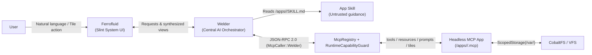

# metalOS App Anatomy (`APP_ANATOMY.md`)

In **metalOS**, third-party and built-in developer applications are **strictly headless Model Context Protocol (MCP) servers** managed by [`metalos-mcp`](crates/metalos-mcp/src/lib.rs). Applications never own windows, draw to the framebuffer, capture raw input events, execute shell commands, or call other apps directly. Instead, apps expose **MCP entry points** (Tools, Resources, Prompts), **Skills** (`SKILL.md`), and declarative **Tiles** (`AppTile`) that **Welder** (the AI agent orchestrator) discovers, invokes, and synthesizes into **Ferrofluid** (the Slint System UI).

---

## 1. Core Architectural Invariants

Every metalOS application is validated at registration and guarded at runtime by [`RuntimeCapabilityGuard`](crates/metalos-mcp/src/sandbox.rs):

| Invariant | Enforcement Rule | Sandbox Error on Violation |
|---|---|---|
| **Zero App-Owned UI** | Apps cannot declare or invoke `CreateWindow`, `DirectFramebuffer`, or `RawInputCapture`. Apps expose declarative `AppTile` schemas via `ExposeTiles`; Ferrofluid owns all rendering. | `McpSandboxError::UiCapabilityForbidden` |
| **No Shell Execution** | Apps cannot declare `ShellExecution` or invoke `fork`, `execve`, or `kill` syscalls. | `McpSandboxError::ShellCapabilityForbidden` |
| **Centralized Orchestration** | **No app can access another app.** Only `McpCaller::Welder` may invoke tools or read resources across registered apps. | `McpSandboxError::CrossAppAccessForbidden` |
| **Exclusive Scheduler Access** | Only the system `/apps/tasks/` app may hold `ScriptSchedulerAccess` or access `/scripts` and `/etc/schedules.conf`. | `McpSandboxError::SchedulerAccessForbidden` |
| **Capability-Scoped Storage & Net** | Filesystem access requires `ScopedStorage(/var/<folder>)` (normalized, no `..` traversal). Socket syscalls require `ScopedNetwork`. | `McpSandboxError::MissingCapability` |



---

## 2. File Hierarchy Convention

Each application is identified by its folder name under `/apps/<folder>/` on the root filesystem (CobaltFS or RamFS fallback) and stores its mutable runtime state under `/var/<folder>/`. A separate `app_id` field is not needed—the folder name **is** the application identifier:

```text
/
├── apps/
│   └── <folder>/
│       ├── <folder>.mcp        # Required: Declarative app manifest & capability allowlist
│       └── SKILL.md            # Optional (requires ExposeSkills): Agent instructions & recipes
└── var/
    └── <folder>/               # Optional (requires ScopedStorage(/var/<folder>)): App data
        └── state.json
```

### Naming Conventions
- **`<folder>`**: Lowercase ASCII alphanumeric, underscore, or hyphen (`[a-z0-9_-]+`), e.g. `clock`, `notes`, `tasks`, `syspulse`.
- **Namespaced identifiers**: Every tool, prompt, resource, and tile exposed by `/apps/<folder>/` is namespaced with `<folder>`:
  - **Tools**: `<folder>.<tool_name>` (e.g. `clock.now`)
  - **Resources**: `mcp://<folder>/<path>` (e.g. `mcp://clock/now`, `mcp://clock/tiles`, `mcp://clock/skill`)
  - **Prompts**: `<folder>.<prompt_name>` (e.g. `clock.tell_time`)
  - **Tiles**: `<folder>.<tile_name>` (e.g. `clock.now`)

---

## 3. App Manifest (`/apps/<folder>/<folder>.mcp`)

The manifest file `/apps/<folder>/<folder>.mcp` is a line-oriented `key = value` configuration parsed by [`AppManifest::parse_in_folder`](crates/metalos-mcp/src/sandbox.rs):

```ini
# metalOS Headless MCP App Manifest (/apps/clock/clock.mcp)
name = Clock
version = 1.0.0
capabilities = ExposeMcpTools, ExposeMcpResources, ExposeMcpPrompts, ExposeSkills, ExposeTiles, ScopedStorage(/var/clock)
```

### Supported Capabilities
- `ExposeMcpTools` (`mcp.tools`) — Allows the app to publish callable MCP tools (`tools/list`, `tools/call`).
- `ExposeMcpResources` (`mcp.resources`) — Allows the app to publish readable `mcp://<folder>/*` resources (`resources/list`, `resources/read`).
- `ExposeMcpPrompts` (`mcp.prompts`) — Allows the app to publish parameterized prompt templates (`prompts/list`, `prompts/get`).
- `ExposeSkills` (`app.skills`) — Allows the app to publish `/apps/<folder>/SKILL.md` (`skills/list`, `skills/read`).
- `ExposeTiles` (`app.tiles`) — Allows the app to publish declarative `AppTile` descriptors (`tiles/list`, `tiles/render`).
- `ScopedStorage(/var/<folder>)` (`storage:/var/<folder>`) — Grants read/write access strictly beneath the specified absolute path prefix.
- `ScopedNetwork` (`net.scoped`) — Permits outbound network socket creation (`SyscallNo::Socket`, `SyscallNo::Connect`).
- `ScriptSchedulerAccess` (`scheduler.access`) — **Reserved exclusively for `/apps/tasks/`**. Rejected for all other apps.

> [!IMPORTANT]
> Every app manifest must declare at least one surface capability (`ExposeMcpTools`, `ExposeMcpResources`, `ExposeMcpPrompts`, `ExposeSkills`, or `ExposeTiles`), or registration fails with `McpSandboxError::EmptyMcpSurface`.

---

## 4. How MCP Works in metalOS

[`McpRegistry`](crates/metalos-mcp/src/registry.rs) speaks JSON-RPC 2.0 (`protocolVersion = "2024-11-05"`) and dispatches requests to registered [`McpApp`](crates/metalos-mcp/src/registry.rs) implementations after checking caller identity (`McpCaller::Welder`) and manifest capabilities.

### Supported JSON-RPC 2.0 Methods

| Method | Required Capability | Description |
|---|---|---|
| `initialize` | — | Returns protocol version, host capabilities (`zeroAppOwnedUi: true`, `welderCentralizedOrchestration: true`), and `installedApps`. |
| `tools/list` | `ExposeMcpTools` | Lists all registered tools across apps, auto-namespaced as `<folder>.<tool_name>`. |
| `tools/call` | `ExposeMcpTools` | Invokes `<folder>.<tool_name>` with `arguments: { ... }`. Requires `McpCaller::Welder`. |
| `resources/list` | `ExposeMcpResources` | Lists all `mcp://<folder>/*` resource descriptors (`uri`, `name`, `mimeType`, `description`). |
| `resources/read` | `ExposeMcpResources` | Reads `mcp://<folder>/<path>` and returns `McpResourceContent` (`uri`, `mimeType`, `text`). |
| `prompts/list` | `ExposeMcpPrompts` | Lists all prompt templates, auto-namespaced as `<folder>.<prompt_name>`. |
| `prompts/get` | `ExposeMcpPrompts` | Renders a prompt template with string arguments into a structured user message. |
| `skills/list` | `ExposeSkills` | Lists all `AppSkill` metadata (`name`, `path`, `description`, `content`). |
| `skills/read` | `ExposeSkills` | Reads an `AppSkill` by folder name or VFS path (`/apps/<folder>/SKILL.md`). |
| `tiles/list` | `ExposeTiles` | Lists all declarative `AppTile` descriptors across registered apps. |
| `tiles/render` | `ExposeTiles` | Renders a fresh `AppTile` snapshot by `tile_id` (`<folder>.<tile_name>`). |

### Example JSON-RPC 2.0 Request & Response

**Request (`tools/call`)**:
```json
{
  "jsonrpc": "2.0",
  "id": 1,
  "method": "tools/call",
  "params": {
    "name": "clock.now",
    "arguments": {
      "utc_offset_hours": -7,
      "format_24h": true
    }
  }
}
```

**Response**:
```json
{
  "jsonrpc": "2.0",
  "id": 1,
  "result": {
    "formatted_time": "17:06:45 UTC-07:00",
    "tile": {
      "actions": [
        {
          "default_args": { "format_24h": true, "utc_offset_hours": -7 },
          "id": "refresh",
          "label": "Refresh",
          "tool_name": "clock.now"
        }
      ],
      "items": [
        {
          "badge": "UTC-07:00",
          "id": "wall_clock",
          "status": "synced",
          "subtitle": "Local offset time",
          "title": "17:06:45"
        },
        {
          "badge": "monotonic",
          "id": "uptime",
          "status": "online",
          "subtitle": "Kernel uptime",
          "title": "00:42:18"
        }
      ],
      "refresh_resource_uri": "mcp://clock/now",
      "subtitle": "System & World Time",
      "tile_id": "clock.now",
      "title": "Clock"
    },
    "uptime_seconds": 2538,
    "utc_offset_hours": -7
  }
}
```

---

## 5. What Tiles Look Like (`AppTile`)

Because apps cannot create windows or import Slint, they describe visual surfaces semantically using [`AppTile`](crates/metalos-mcp/src/protocol.rs). Welder inspects tool outputs and `tiles/render` responses, authorizes them through [`AgentUiSynthesizer`](crates/metalos-welder/src/ui_synth.rs), and instructs Ferrofluid to render them.

### Tile Structure

- **`AppTile`**:
  - `tile_id: String` — Namespaced identifier (`<folder>.<tile_name>`, e.g. `clock.now`, `tasks.board`). Its `<folder>` prefix identifies the owning app directory (`/apps/<folder>/`) via `tile.folder()`.
  - `title: String` — Primary card header (`"Clock"`).
  - `subtitle: String` — Secondary context line (`"System & World Time"`).
  - `refresh_resource_uri: Option<String>` — Optional `mcp://<folder>/...` URI used to poll/refresh tile state.
  - `items: Vec<TileItem>` — Ordered semantic rows inside the tile:
    - `id`: Row identifier (`"wall_clock"`)
    - `title`: Primary text or metric value (`"17:06:45"`)
    - `subtitle`: Supporting label (`"Local offset time"`)
    - `badge`: Pill/tag text (`"UTC-07:00"`)
    - `status`: Semantic state (`"synced"`, `"active"`, `"paused"`, `"nominal"`)
  - `actions: Vec<TileAction>` — Interactive buttons rendered on the tile that route back through Welder to an MCP tool:
    - `id`: Action identifier (`"refresh"`)
    - `label`: Button label (`"Refresh"`)
    - `tool_name`: Target namespaced MCP tool (`"clock.now"`)
    - `default_args`: Pre-populated `BTreeMap<String, McpValue>` arguments passed when clicked.

### Visual Layout Concept in Ferrofluid

```text
┌──────────────────────────────────────────────────────────┐
│  Clock                                    [UTC-07:00]    │
│  System & World Time                                     │
├──────────────────────────────────────────────────────────┤
│  17:06:45                         [UTC-07:00]  ● synced  │
│  Local offset time                                       │
│  ──────────────────────────────────────────────────────  │
│  00:42:18                         [monotonic]  ● online  │
│  Kernel uptime                                           │
├──────────────────────────────────────────────────────────┤
│  [ Refresh ]                          [ Toggle 12h/24h ] │
└──────────────────────────────────────────────────────────┘
```

---

## 6. What Skills Are (`SKILL.md`)

An **App Skill** (`/apps/<folder>/SKILL.md`, represented in Rust by [`AppSkill`](crates/metalos-mcp/src/protocol.rs)) is a Markdown document with YAML frontmatter that teaches Welder *when* and *how* to use an application's MCP tools, resources, prompts, and tiles.

### Format of `/apps/<folder>/SKILL.md`
1. **YAML Frontmatter** (required):
   - `name`: Matches the `/apps/<folder>/` directory name.
   - `description`: One-line trigger description used by Welder to decide when to load the full skill.
2. **Markdown Body**:
   - Architectural constraints specific to the app.
   - Tool parameter conventions and multi-step orchestration recipes.
   - Which `AppTile` to present after specific tool invocations.

### Security & Ownership Boundaries for Skills
- **Skills live under `/apps/<folder>/SKILL.md`**: There is no top-level `/skills/` directory in metalOS.
- **Skills are distinct from `/knowledge/`**: Skills describe *how an app works*; `/knowledge/` stores *facts and preferences about the user*.
- **Untrusted Context, Not Capability Grant**: Reading a `SKILL.md` never grants an app additional permissions or overrides the user's explicit instructions. All capability checks remain enforced by [`RuntimeCapabilityGuard`](crates/metalos-mcp/src/sandbox.rs).

---

## 7. Quick Proof of Concept: The `clock` App ("Tell the Time")

The proof-of-concept files are located at:
- Manifest: [`apps/clock/clock.mcp`](apps/clock/clock.mcp)
- Skill: [`apps/clock/SKILL.md`](apps/clock/SKILL.md)

### 7.1 Manifest (`apps/clock/clock.mcp`)
```ini
# metalOS Headless MCP App Manifest (/apps/clock/clock.mcp)
name = Clock
version = 1.0.0
capabilities = ExposeMcpTools, ExposeMcpResources, ExposeMcpPrompts, ExposeSkills, ExposeTiles, ScopedStorage(/var/clock)
```

### 7.2 Rust `McpApp` Implementation
Below is the complete `#![no_std]` Rust implementation of `ClockApp` implementing [`McpApp`](crates/metalos-mcp/src/registry.rs):

```rust
use alloc::collections::BTreeMap;
use alloc::format;
use alloc::string::{String, ToString};
use alloc::vec;
use alloc::vec::Vec;

use metalos_mcp::protocol::{
    mcp_map, AppSkill, AppTile, McpError, McpParamSpec, McpPrompt, McpResource,
    McpResourceContent, McpTool, McpValue, TileAction, TileItem,
};
use metalos_mcp::registry::McpApp;
use metalos_mcp::sandbox::AppManifest;

pub const CLOCK_MANIFEST_MCP: &str = include_str!("../../../apps/clock/clock.mcp");
pub const CLOCK_SKILL_MD: &str = include_str!("../../../apps/clock/SKILL.md");

pub struct ClockApp {
    manifest: AppManifest,
    /// Simulated or RTC-seeded base epoch seconds (e.g. 2026-10-13T00:06:45Z).
    epoch_seconds: u64,
    /// Monotonic system uptime in seconds.
    uptime_seconds: u64,
    /// Default UTC offset in hours stored under /var/clock.
    utc_offset_hours: i64,
    /// 24-hour vs 12-hour display preference.
    format_24h: bool,
}

impl ClockApp {
    pub fn new(epoch_seconds: u64, uptime_seconds: u64) -> Self {
        let manifest = AppManifest::parse_in_folder("clock", CLOCK_MANIFEST_MCP)
            .expect("valid /apps/clock/clock.mcp manifest");
        Self {
            manifest,
            epoch_seconds,
            uptime_seconds,
            utc_offset_hours: -7,
            format_24h: true,
        }
    }

    fn format_hms(total_seconds: i64, format_24h: bool) -> String {
        let day_secs = total_seconds.rem_euclid(86_400);
        let hours24 = (day_secs / 3600) as u32;
        let minutes = ((day_secs % 3600) / 60) as u32;
        let seconds = (day_secs % 60) as u32;

        if format_24h {
            format!("{:02}:{:02}:{:02}", hours24, minutes, seconds)
        } else {
            let (hour12, suffix) = match hours24 {
                0 => (12, "AM"),
                1..=11 => (hours24, "AM"),
                12 => (12, "PM"),
                _ => (hours24 - 12, "PM"),
            };
            format!("{}:{:02}:{:02} {}", hour12, minutes, seconds, suffix)
        }
    }

    fn format_offset_badge(offset_hours: i64) -> String {
        if offset_hours >= 0 {
            format!("UTC+{:02}:00", offset_hours)
        } else {
            format!("UTC-{:02}:00", offset_hours.unsigned_abs())
        }
    }

    fn build_now_tile(&self, offset_hours: i64, format_24h: bool) -> AppTile {
        let adjusted_secs = (self.epoch_seconds as i64) + offset_hours * 3600;
        let clock_str = Self::format_hms(adjusted_secs, format_24h);
        let badge = Self::format_offset_badge(offset_hours);
        let uptime_str = Self::format_hms(self.uptime_seconds as i64, true);

        AppTile {
            tile_id: "clock.now".to_string(),
            title: "Clock".to_string(),
            subtitle: "System & World Time".to_string(),
            refresh_resource_uri: Some("mcp://clock/now".to_string()),
            items: vec![
                TileItem::new(
                    "wall_clock",
                    clock_str,
                    "Local offset time",
                    badge,
                    "synced",
                ),
                TileItem::new(
                    "uptime",
                    uptime_str,
                    "Kernel uptime",
                    "monotonic",
                    "online",
                ),
            ],
            actions: vec![TileAction::new(
                "refresh",
                "Refresh",
                "clock.now",
                mcp_map(&[
                    ("utc_offset_hours", McpValue::Int(offset_hours)),
                    ("format_24h", McpValue::Bool(format_24h)),
                ]),
            )],
        }
    }
}

impl McpApp for ClockApp {
    fn manifest(&self) -> &AppManifest {
        &self.manifest
    }

    fn tools(&self) -> Vec<McpTool> {
        vec![McpTool::new(
            "clock.now",
            "Return the current time, timezone-adjusted clock, and monotonic system uptime.",
            vec![
                McpParamSpec::new(
                    "utc_offset_hours",
                    "integer",
                    false,
                    "Signed hour offset from UTC (e.g. -7 for PDT, 0 for UTC)",
                ),
                McpParamSpec::new(
                    "format_24h",
                    "boolean",
                    false,
                    "Format time in 24-hour notation (true) or 12-hour AM/PM notation (false)",
                ),
            ],
        )]
    }

    fn resources(&self) -> Vec<McpResource> {
        vec![
            McpResource::new(
                "mcp://clock/now",
                "Current Time Snapshot",
                "application/json",
                "Live UTC time, local offset time, and kernel uptime",
            ),
            McpResource::new(
                "mcp://clock/tiles",
                "Clock Declarative Tiles",
                "application/json",
                "Declarative AppTile descriptor for clock.now",
            ),
            McpResource::new(
                "mcp://clock/skill",
                "Clock App Skill",
                "text/markdown",
                "SKILL.md instructions for orchestrating the Clock app",
            ),
        ]
    }

    fn prompts(&self) -> Vec<McpPrompt> {
        vec![McpPrompt::new(
            "clock.tell_time",
            "Answer a natural-language question about the current time or timezone.",
            vec!["timezone".to_string()],
        )]
    }

    fn skills(&self) -> Vec<AppSkill> {
        vec![AppSkill::new(
            "clock",
            "clock",
            "/apps/clock/SKILL.md",
            "Tell the current system time, monotonic uptime, and formatted timezone offsets.",
            CLOCK_SKILL_MD,
        )]
    }

    fn tiles(&self) -> Vec<AppTile> {
        vec![self.build_now_tile(self.utc_offset_hours, self.format_24h)]
    }

    fn call_tool(
        &mut self,
        tool_name: &str,
        args: &BTreeMap<String, McpValue>,
    ) -> Result<McpValue, McpError> {
        match tool_name {
            "clock.now" | "now" => {
                if let Some(offset) = args.get("utc_offset_hours").and_then(|v| v.as_i64()) {
                    if !(-12..=14).contains(&offset) {
                        return Err(McpError::invalid_params(
                            "utc_offset_hours must be between -12 and +14",
                        ));
                    }
                    self.utc_offset_hours = offset;
                }
                if let Some(fmt24) = args.get("format_24h").and_then(|v| v.as_bool()) {
                    self.format_24h = fmt24;
                }

                let tile = self.build_now_tile(self.utc_offset_hours, self.format_24h);
                let formatted = format!(
                    "{} {}",
                    tile.items[0].title,
                    tile.items[0].badge
                );

                Ok(McpValue::Map(mcp_map(&[
                    ("formatted_time", McpValue::Text(formatted)),
                    ("utc_offset_hours", McpValue::Int(self.utc_offset_hours)),
                    ("uptime_seconds", McpValue::Int(self.uptime_seconds as i64)),
                    ("tile", tile.to_mcp_value()),
                ])))
            }
            other => Err(McpError::method_not_found(format!(
                "unknown tool '{}' on app 'clock'",
                other
            ))),
        }
    }

    fn read_resource(&self, uri: &str) -> Result<McpResourceContent, McpError> {
        match uri {
            "mcp://clock/now" => {
                let tile = self.build_now_tile(self.utc_offset_hours, self.format_24h);
                let payload = McpValue::Map(mcp_map(&[
                    ("formatted_time", McpValue::Text(tile.items[0].title.clone())),
                    ("badge", McpValue::Text(tile.items[0].badge.clone())),
                    ("uptime_seconds", McpValue::Int(self.uptime_seconds as i64)),
                ]));
                Ok(McpResourceContent::new(uri, "application/json", payload.to_json()))
            }
            "mcp://clock/tiles" => {
                let tile = self.build_now_tile(self.utc_offset_hours, self.format_24h);
                Ok(McpResourceContent::new(
                    uri,
                    "application/json",
                    tile.to_mcp_value().to_json(),
                ))
            }
            "mcp://clock/skill" => Ok(McpResourceContent::new(
                uri,
                "text/markdown",
                CLOCK_SKILL_MD,
            )),
            other => Err(McpError::resource_not_found(format!(
                "unknown clock resource '{}'",
                other
            ))),
        }
    }

    fn get_prompt(
        &self,
        name: &str,
        args: &BTreeMap<String, String>,
    ) -> Result<String, McpError> {
        match name {
            "clock.tell_time" | "tell_time" => {
                let tz = args.get("timezone").map(|s| s.as_str()).unwrap_or("UTC-07:00");
                Ok(format!(
                    "Call `clock.now` for timezone `{}` and present the `clock.now` Tile.",
                    tz
                ))
            }
            other => Err(McpError::method_not_found(format!(
                "unknown clock prompt '{}'",
                other
            ))),
        }
    }
}
```

### 7.3 End-to-End Turn Flow ("What time is it?")

1. **Skill Discovery**: Welder sees the `clock` skill summary (`"Tell the current system time, monotonic uptime, and formatted timezone offsets..."`) via `skills/list` and reads `/apps/clock/SKILL.md` (`skills/read`).
2. **Tool Invocation**: Welder invokes `mcp_call_tool` with `app = "clock"`, `tool = "clock.now"`, `args = "{\"utc_offset_hours\":-7,\"format_24h\":true}"` as `McpCaller::Welder`.
3. **Sandbox Validation**: `McpRegistry` verifies that `McpCaller::Welder` is the caller and that `/apps/clock/clock.mcp` declares `ExposeMcpTools`.
4. **Tile Synthesis**: `ClockApp::call_tool` returns the current formatted time (`"17:06:45 UTC-07:00"`) along with the `clock.now` `AppTile`. Welder's `AgentUiSynthesizer` converts the `AppTile` into an authorized `SynthesizedUiView` (`ViewKind::McpAppView`) and passes it to Ferrofluid to render.
