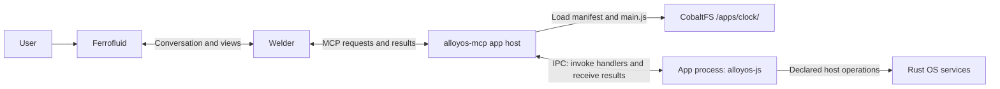

# Getting started with alloyOS apps

Build a alloyOS app by writing JavaScript, a manifest, and an optional skill.
Your app exposes tools and data to **Welder**, which presents them through
**Ferrofluid**. The Clock example below shows the complete path from a developer's
files to a time display and a Refresh action.

**Implementation status:** app discovery and JavaScript execution are implemented.
App packages are copied from the repository's `apps/` tree into the CobaltFS disk
image by the image build. The OS lists `/apps/` at runtime, validates each package,
and loads its `main.js` for local apps. Remote MCP packages use an endpoint instead.
App identities, source files, and package lists are never
embedded in Rust. An empty `/apps/` exposes no apps.

## How your app runs

The kernel, CobaltFS, Forge, Welder, Ferrofluid, and the MCP app host are Rust OS
services. **Local apps are JavaScript packages on disk.** Remote MCP packages store
their endpoint and schemas on disk and execute on the remote server.

`alloyos-mcp` owns app execution through `alloyos-js`. Welder invokes the MCP host;
it does not import `alloyos-js`, create app isolates, or execute app source itself.
The host loads your JavaScript into a capability-scoped execution environment,
calls a handler, validates its result, and returns it to Welder.



An app returns semantic **Tiles**: titles, rows, badges, and tool actions. Welder
selects the view and Ferrofluid draws it. Apps do not open windows, draw pixels,
receive raw keyboard events, run shells, or call other apps. To combine two apps,
Welder invokes each app separately.

Each app must run in its own OS process, with a private virtual address space
and independently scheduled execution. The process hosts `alloyos-js`; its
JavaScript isolates enforce the manifest's capabilities within that process.
The MCP host invokes handlers through IPC. An app crash or infinite loop must
not stop Welder, Ferrofluid, or another app.

**Not implemented yet:** today's app registry executes app implementations inside
the host. Process isolation is required migration work tracked in
[Roadmap Phase 7](ROADMAP.md#phase-7-headless-mcp-apps-skills-declarative-tiles--tasks-app).

## Remote MCP packages and Smithery lookup

Welder exposes `smithery_search`, `smithery_install`, and `smithery_uninstall`.
Search accepts a query and optional `page` and `page_size`, forwards them to
Smithery, and returns its results and pagination. Empty results stay empty;
unavailable transport, authentication errors, and malformed responses fail explicitly.

Install takes the exact Smithery qualified name, uses its deployment URL and tool
schemas, validates the package, and refuses to overwrite an existing package.
It creates `<app_id>.mcp`, `tools.json`, and `SKILL.md` under `/apps/<app_id>/`.
Remote manifests declare `endpoint`, `transport = streamable-http`, and
`ScopedNetwork`; they can omit `main.js`. Supplied JavaScript still undergoes the
normal source-size and parsing checks. Remote apps expose headless capabilities;
they do not render local Tiles.

**Transport status:** the host must install an `alloyos_mcp::transport::HttpTransport`
through `NativeToolRegistry::set_http_transport`. The kernel currently does not
wire this driver. Without one, only explicitly registered test fixtures work.
The driver owns bounded HTTP I/O and credentials, including Smithery's required
API key; credentials do not belong in package manifests. This interface does not
implement OAuth or a cooperative kernel network driver.

The MCP client initializes the server, retains session headers, sends JSON-RPC
POSTs to its endpoint, and checks response IDs. It handles JSON and completed SSE
responses and retains all tool content, structured results, and `isError`. Remote
resource aliases use `mcp://<app_id>/resources/<index>`; the current OS resource
interface accepts one text content block and reports unsupported shapes explicitly.
Installation and removal roll back file changes when storage or registration
fails, and report rollback failures instead of reporting success.

## 1. Create the Clock package

Use a lowercase folder name containing letters, digits, underscores, or hyphens.
The folder is the app's identifier; all public names use it as their namespace.

```text
/apps/clock/        # Installed package; read-only to apps
├── clock.mcp       # Identity, permissions, and public schemas
├── SKILL.md        # Instructions that help Welder use Clock
└── main.js         # JavaScript handlers

/var/clock/         # Writable app data
```

The repository currently contains [Clock's manifest](apps/clock/clock.mcp) and
[skill](apps/clock/SKILL.md), and [JavaScript implementation](apps/clock/main.js).
The longer example below illustrates the target SDK contract. **`/apps/` is read-only to apps.** App data and preferences belong
under **`/var/<app_id>/`**, with writes confined to that app's own directory. For Clock, this is `/var/clock/`. The OS manages package installation
and updates under `/apps/` through Welder's authorized app-update flow.

The current package loader also reads `tools.json`, `resources.json`,
`prompts.json`, and `tiles.json` alongside the manifest. `tiles.json` is a JSON
array of tile IDs, such as `["clock.now"]`; the host passes those IDs to
`renderTile`. These metadata files make each package discoverable without
application-specific Rust code. Apps that declare `ScriptSchedulerAccess` receive
the scheduler bindings and scheduler storage scopes, regardless of folder name.
Runtime scans detect installed, changed, invalid, and removed packages. Boot does
not install or repair application files.

Use these names consistently:

| Surface | Clock example |
|---|---|
| Tool | `clock.now` |
| Resource | `mcp://clock/now` |
| Prompt | `clock.tell_time` |
| Tile | `clock.now` |
| Skill | `/apps/clock/SKILL.md` |

## 2. Describe the app in `clock.mcp`

The manifest is the host's source of truth for discovery, validation, and
permissions. Tool schemas describe what Welder can pass; Tile schemas describe
what the host will accept. JavaScript implements the declared behavior, and
`SKILL.md` explains how to use it.

The **target manifest contract** retains `key = value` configuration. Descriptor
keys (`tool`, `resource`, `prompt`, and `tile`) are repeatable, with one JSON object
per line. The descriptor keys require extending the existing manifest parser.
The `ReadClock` grant and `AlloyOS.clock.now()` binding below are also part of
```ini
# /apps/clock/clock.mcp
name = Clock
version = 1.0.0
capabilities = ExposeMcpTools, ExposeMcpResources, ExposeMcpPrompts, ExposeSkills, ExposeTiles, ReadClock

tool = {"name":"clock.now","description":"Read the current time and uptime.","inputSchema":{"type":"object","properties":{"utc_offset_hours":{"type":"integer","minimum":-12,"maximum":14,"default":0},"format_24h":{"type":"boolean","default":true}},"additionalProperties":false}}
resource = {"uri":"mcp://clock/now","name":"Current time","mimeType":"application/json"}
prompt = {"name":"clock.tell_time","description":"Answer a time question using Clock.","arguments":[{"name":"timezone","required":false}]}
tile = {"tile_id":"clock.now","schema":"AppTile"}
```

`schema = "AppTile"` selects the host's standard Tile schema, whose fields are
shown in step 3. A tool result containing a Tile must satisfy that schema too.

## 3. Implement `main.js`

The host-visible handler contract is:

| Handler | Called for | Return value |
|---|---|---|
| `callTool(name, args)` | `tools/call` | JSON text containing the tool result |
| `readResource(uri)` | `resources/read` | JSON text for a JSON resource |
| `getPrompt(name, args)` | `prompts/get` | Prompt text |
| `renderTile(tileId)` | `tiles/render` | JSON text containing an `AppTile` |

Define ordinary named functions at the top level. The host invokes them by name;
this contract does not require ES module `export` syntax, Node.js packages, or
browser APIs. Discovery comes from the manifest, so handlers do not implement
`tools/list` or parse JSON-RPC envelopes. Implement only the handlers for the
surfaces you declare.

The target `AlloyOS.clock.now()` binding returns a fresh OS snapshot with
`epoch_seconds` (UTC wall-clock time) and `uptime_seconds` (monotonic uptime).
Wall-clock time must come from a real clock source; uptime alone cannot establish
the current date or time. If that source is unavailable, the host reports an error
instead of inventing a timestamp.

```javascript
// /apps/clock/main.js
function pad2(value) {
    if (value < 10) { return "0" + value; }
    return "" + value;
}

function formatTime(seconds, use24h) {
    let day = ((seconds % 86400) + 86400) % 86400;
    let hour = Math.floor(day / 3600);
    let minute = Math.floor((day % 3600) / 60);
    let second = day % 60;
    let suffix = "";
    if (!use24h) {
        suffix = hour < 12 ? " AM" : " PM";
        hour = hour % 12;
        if (hour === 0) { hour = 12; }
    }
    return pad2(hour) + ":" + pad2(minute) + ":" + pad2(second) + suffix;
}

function snapshot(args) {
    let offset = args.utc_offset_hours || 0;
    let use24h = args.format_24h !== false;
    let now = AlloyOS.clock.now();
    let time = formatTime(now.epoch_seconds + offset * 3600, use24h);
    let badge = "UTC" + (offset < 0 ? "-" : "+") + pad2(Math.abs(offset)) + ":00";
    return {
        formatted_time: time + " " + badge,
        utc_offset_hours: offset,
        uptime_seconds: now.uptime_seconds,
        tile: {
            tile_id: "clock.now",
            title: "Clock",
            subtitle: "System & World Time",
            refresh_resource_uri: "mcp://clock/now",
            items: [{id: "wall_clock", title: time, subtitle: "Local offset time",
                     badge: badge, status: "synced"}],
            actions: [{id: "refresh", label: "Refresh", tool_name: "clock.now",
                       default_args: {utc_offset_hours: offset, format_24h: use24h}}]
        }
    };
}

function callTool(name, args) {
    if (name !== "clock.now") { throw new Error("Unknown Clock tool"); }
    return JSON.stringify(snapshot(args));
}

function readResource(uri) {
    if (uri !== "mcp://clock/now") { throw new Error("Unknown Clock resource"); }
    return JSON.stringify(snapshot({}));
}

function getPrompt(name, args) {
    if (name !== "clock.tell_time") { throw new Error("Unknown Clock prompt"); }
    return "Call clock.now and present the clock.now Tile. Use a UTC offset if requested.";
}

function renderTile(tileId) {
    if (tileId !== "clock.now") { throw new Error("Unknown Clock Tile"); }
    return JSON.stringify(snapshot({}).tile);
}
```

The host validates tool arguments before invoking `callTool`, including the
integer offset range and boolean format. It parses returned JSON and validates
namespaces, Tile fields, resource URIs, and action targets. Unknown handlers,
invalid JSON, host failures, or execution limits become structured MCP errors that
Welder can explain in the chat.

Each invocation must work in a fresh isolate. Do not rely on globals surviving
between calls; store durable preferences in `/var/clock/`. A
Refresh action preserves the selected format through `default_args`. Clock's
resource and standalone Tile use UTC and 24-hour defaults in this minimal example.

This example handles fixed UTC offsets. Named time zones and daylight-saving
rules need a time-zone service; `-7` is not a year-round rule for Los Angeles.

## 4. Teach Welder with `SKILL.md`

A skill supplies usage guidance, not permissions. Its frontmatter identifies the
app and explains when Welder should load the instructions.

```markdown
---
name: clock
description: Read the current time and uptime, and present a Clock Tile.
---

# Clock

Use clock.now when the user asks for the time or system uptime.
Pass utc_offset_hours when the user requests a fixed UTC offset.
Use format_24h=false for a 12-hour display.

Present the returned clock.now Tile. Its Refresh action calls clock.now again.
Do not infer UTC wall-clock time from uptime. Explain clock-source errors to the user.
```

The host serves this file through `skills/list` and `skills/read`; JavaScript does
not need a handler just to return its skill. Welder treats app skills as untrusted
guidance and follows the user's instructions when they conflict.

## 5. Follow one request through the OS

For “What time is it at UTC−7?”, Welder discovers `clock.now` and its input schema,
then sends this request to the MCP host:

```json
{
  "jsonrpc": "2.0",
  "id": 1,
  "method": "tools/call",
  "params": {
    "name": "clock.now",
    "arguments": {"utc_offset_hours": -7, "format_24h": true}
  }
}
```

The host authenticates Welder as the caller, checks Clock's manifest, validates
the arguments, loads `/apps/clock/main.js`, and invokes `callTool` in the scoped
isolate. It decodes the JSON result and returns it through MCP. Welder presents
the time and hands the validated Tile to Ferrofluid. Tapping Refresh follows the
same Welder → MCP host → JavaScript path.

The host implements discovery methods (`tools/list`, `resources/list`,
`prompts/list`, `skills/list`, and `tiles/list`) from the installed package.
`resources/read`, `prompts/get`, and `tiles/render` dispatch to their corresponding
handlers. Apps never construct the final MCP response envelope themselves.

## 6. Install and update your app

Add your app package under `/apps/<app_id>/`. For Clock, place `clock.mcp`,
`SKILL.md`, and `main.js` in `/apps/clock/`.

Welder automatically discovers and validates all installed apps. Whenever you
add or change a package, Welder checks it again and lets the user know if there
is a problem with your app, including what failed and where to fix it. You do
not need to register the app manually or request a reload.

Users can ask Welder which apps are installed and whether any of them have errors.
App data stays under `/var/<app_id>/`; `/apps/` remains read-only to running apps.

Automatic discovery and validation are planned in
[Roadmap Phase 7](ROADMAP.md#phase-7-headless-mcp-apps-skills-declarative-tiles--tasks-app).

## Optional first-run setup contract

The built-in system setup wizard belongs to Welder (`alloyos-welder::setup`),
not an installable app. Questions and answers appear in the chat interface, never as widget tiles. It saves resumable progress to `/etc/setup.json`, writes
Clock preferences through `clock.configure` (the Clock app owns its scoped local
storage), and lets users select installed apps for
Dashboard pins. It offers packages actually discovered under `/apps/` and can
search the existing Smithery registry with `search <service>`. Installation is an
explicit action on a returned result, through the existing validated installer.
Registry or transport failures remain visible and do not block finishing setup;
Package Manager also remains available later.
The wizard keeps only draft answers for resuming its form. Clock validates and
persists timezone/format in `/var/clock/preferences.json`; the review calls
`clock.settings` to show the app's current values rather than treating saved
wizard drafts as authoritative. If Clock is unavailable, its step can be skipped.

An app can opt into setup orchestration by exposing these namespaced MCP tools:

- `<app_id>.setup_status`: inspect readiness without starting authorization.
- `<app_id>.setup_start`: start or resume the app's own setup/authorization.

Both receive `{}` and return a JSON object with `status` equal to `ready`,
`needs_setup`, `waiting`, or `error`, plus an optional short `message`. For remote
MCP results, the same object may appear in `structuredContent` or a JSON text
content block. The wizard records the reported status and lets users retry,
continue, or defer. Apps without these hooks remain installed with readiness
unreported; package validation alone never means account authorization succeeded.
Do not return credentials in setup messages. Credentials and authorization stay
inside the app/transport; Welder does not implement a shared account login broker.

The wizard does not change providers, networks, appearance, keyboard layouts, or
accessibility settings. `/setup`, "open setup", and "finish setting up my system"
reopen it. Learning preferences use the existing `/knowledge` controls; connecting
or selecting an app never grants additional action permissions.
