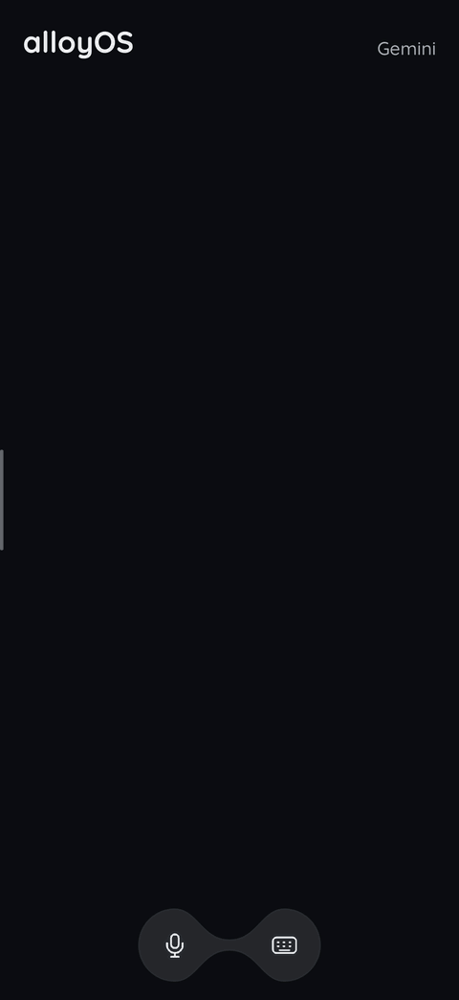
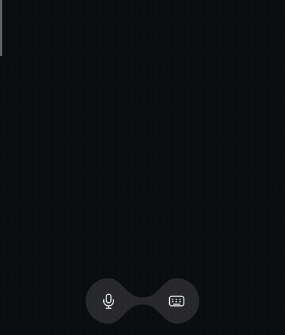
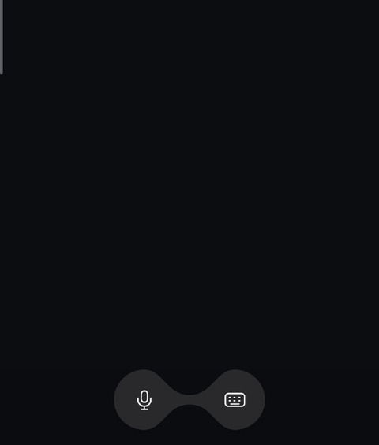
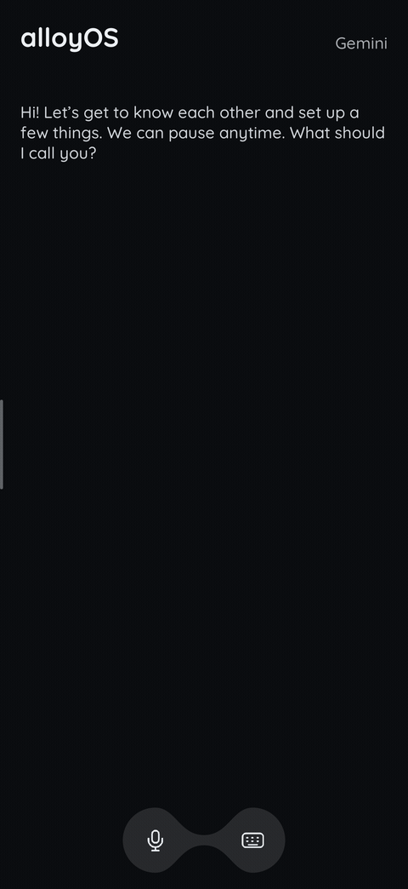
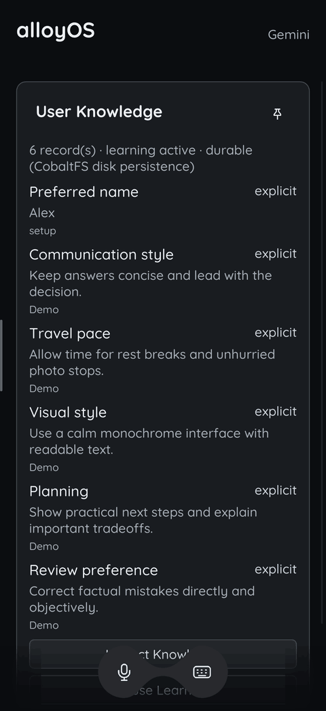

<p align="center">
  
</p>

# alloyOS

> **The desktop metaphor is dead weight. Stop bolting AI onto 1970s operating systems.**

**alloyOS** is an AI-first, bare-metal operating system written from scratch in `#![no_std]` Rust (`aarch64`, native `-accel hvf`). There is no POSIX baggage, no multi-user permission labyrinth, and no window manager cluttered with half-broken apps. It boots through a liquid-metal splash directly into **Ferrofluid (`ferrofluidd`)**—a display server driven entirely by a pluggable frontier model (**Gemini**, **Claude**, **ChatGPT**).

## UI Demos

alloyOS is a real operating system that boots in QEMU. These demos show the actual
Ferrofluid renderer, with Setup Wizard powered by the Welder setup controller
and Clock app.

**Ask for weather → pin the widget → pull open the sidebar.**



| Keyboard | Mic | Boot |
| :---: | :---: | :---: |
|  |  |  |
| Reveal, key feedback, and dismissal. | Activation, voice levels, and mute. | Loading animation and workspace transition. |

### Setup Wizard

Choose your name, name your assistant, set your region and clock format, and
choose whether alloyOS may learn your preferences.



See [capture notes](assets/demos/README.md) for provenance and reproduction.

## The Manifesto

1. **No Filesystem Maze. No Shell.**
   Users shouldn't be system administrators, and AI agents shouldn't act through brittle string-piped shell commands (`sh`, `exec`, `spawn`). State lives in structured storage and typed capabilities. Neither the user nor the agent ever touches a raw shell.
2. **Zero Third-Party UI.**
   Every app shipping its own interface guarantees visual chaos, bloated binaries, and fragmented workflows. In **alloyOS**, third-party software is strictly headless. Developers ship pure capabilities—**Model Context Protocol (MCP)** endpoints and isolated `#![no_std]` JS tasks—never pixels.
3. **Agent-Exclusive Rendering.**
   Only the AI agent holds the capability token to paint surfaces in **Ferrofluid**. You never see inconsistent junk UI, dark patterns, or settings menus you didn't ask for. You see only what matters right now, synthesized by the agent in the highest-signal form possible.
4. **UI as Ferrofluid.**
   Interfaces should not be static windows nailed to a screen. Under the magnetic pull of intent, the interface coalesces on demand—forming tables, sparklines, controls, or prose—and dissolves back into obsidian the moment the task is done. The UI is molded like **ferrofluid**.

See **[ROADMAP.md](ROADMAP.md)** for the full architecture and milestone plan.

## User Knowledge

The main agent (**Welder**) maintains a local Markdown repository under `/knowledge/`
on CobaltFS to learn durable user facts, preferences, interests, and project context
from conversation. Entries track their source and scope, with inferred observations
kept separate from explicit statements. Welder automatically extracts durable context,
filters credentials, and provides bounded retrieval into model turns. The user can
inspect, correct, delete, or pause learning at any time using natural language or through
the declarative `knowledge.profile` tile.

### Memory controls

Review knowledge entries, scroll with the keyboard open, and pause learning
through the Welder knowledge tile.



Knowledge is user context; skills are supplied by applications under `/apps/`.
There is no separate `/skills/` directory or profile skill. See
[KNOWLEDGE.md](KNOWLEDGE.md) for the design, storage schema, and tool architecture.

## Main Components

alloyOS is composed of modular components designed around capability security, agent orchestration, and headless application isolation:

- **Bootloader** ([`crates/alloyos-boot`](crates/alloyos-boot)):
  Initializes bare-metal hardware, validates physical memory layout, and runs the surface-tension liquid splash sequence before handing execution to the kernel.

- **Display Server (`ferrofluidd`)** ([`crates/alloyos-ferrofluid`](crates/alloyos-ferrofluid)):
  The agent-exclusive display server and compositor. It hosts the bare-metal Slint platform adapter, Quicksand typography, and the soft keyboard ([`crates/alloyos-keyboard`](crates/alloyos-keyboard)), rendering dynamic UI surfaces and cards synthesized by the agent with zero third-party pixel access.

- **Welder** ([`crates/alloyos-welder`](crates/alloyos-welder)):
  The primary OS agent orchestrator. Welder mediates user intent, coordinates MCP tools and schedules, synthesizes declarative UI tiles for Ferrofluid, and executes shell-free native capabilities.

- **Always-On Knowledge System** ([`crates/alloyos-welder`](crates/alloyos-welder), [`KNOWLEDGE.md`](KNOWLEDGE.md)):
  An integrated, background context engine that continuously learns durable user preferences, facts, and project context across conversations. Stored as structured Markdown on persistent CobaltFS, it automatically extracts memories, protects credentials, and injects relevant context into future turns. Users can review, adjust, or pause learning at any time in natural language.

- **Forge** ([`crates/alloyos-forge`](crates/alloyos-forge)):
  The unified model gateway. Forge bridges the operating system to intelligence, supporting resident local models (Gemma) and frontier cloud providers (Gemini, Claude, OpenAI) with streaming inference and on-the-fly model switching.

- **MCP Apps with Isolation** ([`crates/alloyos-mcp`](crates/alloyos-mcp), [`crates/alloyos-js`](crates/alloyos-js)):
  Headless third-party apps built on the Model Context Protocol (MCP). Every app runs in an isolated userland process with dedicated memory and capability boundaries, executing `#![no_std]` JavaScript (`V8Isolate` / `JsRuntime`) without shell or raw filesystem access. Apps export structured tools, resources, and declarative tiles rather than custom UI.

- **MCP Apps through Package Manager** ([`apps/package-manager`](apps/package-manager), [`crates/alloyos-mcp`](crates/alloyos-mcp)):
  Dynamic discovery, installation, and lifecycle management for ecosystem MCP packages (e.g. from Smithery). Packages are verified, installed into `/apps/` on CobaltFS, and registered into Welder's tool inventory at runtime without kernel reboots.

- **Kernel & VFS** ([`crates/alloyos-kernel`](crates/alloyos-kernel), [`crates/alloyos-proto`](crates/alloyos-proto)):
  The core `#![no_std]` `aarch64` kernel providing ARMv8 MMU translation (`TTBR0_EL1`), exception handling (`VBAR_EL1`), round-robin scheduling, capability-gated syscalls, VirtIO hardware drivers, and the VFS with persistent **CobaltFS**. Development, QEMU runner, and testing harness live in [`xtask`](xtask).

## Filesystem

See **[FILESYSTEM.md](FILESYSTEM.md)** for the full directory hierarchy, seeded configuration files, and VFS interface details.

alloyOS uses a Virtual Filesystem Switch ([`vfs.rs`](crates/alloyos-kernel/src/fs/vfs.rs)) supporting:
- **[CobaltFS](crates/alloyos-kernel/src/fs/cobaltfs/README.md)** — Persistent on-disk filesystem based on the ext2 specification, implemented from scratch in Rust and backed by VirtIO-Blk.
- **RamFS** — In-memory filesystem for transient storage.
- **DevFS** — Device nodes (`/dev/tty`, `/dev/null`, `/dev/zero`, `/dev/serial`, `/dev/urandom`).

## Building & Running

Run the UI with resident Gemma using the root launcher:

```sh
./run.sh
# Or use a private token file for the first download:
./run.sh --auth-file /private/path/hf-token
```

In a terminal, the launcher guides you through build tools, optional Claude,
Gemini, or OpenAI API credentials, Gemma access, and launch. Pasted keys are
hidden; optional saved keys live in ignored `.secrets/` files with mode 600.
Forge uses configured keys for Claude, Gemini, and OpenAI through the QEMU
HTTPS bridge. In chat, you can ask to switch models (such as asking for Claude, Gemini, OpenAI, or local Gemma) in natural language, or tap the model name in the header. Gemini is the default; saved model selections are preserved. Requests go to the
selected provider and may incur API charges. The launcher requires `curl` for
certificate-verified HTTPS.

The bottom toolbar has connected microphone and keyboard controls. Tap the mic
to start continuous Gemini voice: the balls merge, the keyboard fades, and
overlapping vector waves follow microphone volume. Tap again to end it. Opening the keyboard
mutes input while retaining the session; tap the mic to resume. Typed messages
during that session go through the live model. Captions and completed turns stay
in the conversation, and Welder's existing tools are available to voice.

Voice currently uses a native macOS audio/WebSocket helper for QEMU, built by the
launcher, and requires a Gemini API key and microphone permission. The Live model
is configured independently of the text model with `voice_model` in `/etc/ai.conf`.
Other selected providers show voice as unavailable. Use headphones for initial
testing: acoustic echo cancellation is not implemented. See
[the voice plan](VOICE_PLAN.md) and [host audio notes](scripts/audio/README.md).

For automation, use `./run.sh --non-interactive` (as the first option).
The launcher downloads and packages missing weights, then builds and runs in
release mode with 16 GiB guest RAM. Accept the Gemma license on Hugging Face
first; authentication defaults to the local `HF_TOKEN` environment variable.
Allow approximately 21 GB disk space. Subsequent launches reuse the model image.
See [scripts/README.md](scripts/README.md) for token storage and download details.

The graphical boot now opens **Ferrofluid System UI**, a Slint window with a
Ferrofluid-owned bare-metal adapter. See [its integration notes](crates/alloyos-ferrofluid/README.md)
for architecture, the host preview, and current limitations. Use `run --debug-shell`
for the serial bring-up shell; the existing shell E2E tests select it automatically.

Build the bootable `aarch64` kernel and launch in QEMU with native Apple Silicon HVF acceleration:

```bash
cargo run --package xtask -- run
```

Run the headless QEMU E2E test suite:

```bash
cargo run --package xtask -- test
```

Enable the repository's pre-push hook once per clone:

```sh
git config --local core.hooksPath .githooks
```

Every push runs `cargo run --package xtask -- ci`: all workspace tests (including
the keyboard UI tests), followed by the bare-metal build and headless QEMU E2E
suite. A failure blocks the upload. This requires the same Rust and QEMU setup
as the normal test suite. Large-file model loading is covered by unit tests for
header sizes, sector alignment, disk bounds, and transfer offsets; CI does not
load multi-gigabyte model fixtures or run real-model inference.

The `test --timeout` option bounds the QEMU suite (default: 60 seconds).

UI screenshot tests compare committed PNG baselines and generate visual diffs
on failure. See [the screenshot test guide](tests/README.md) for running them
and explicitly reviewing baseline updates.

The standard QEMU guest uses 512 MiB RAM and a 256 MiB kernel heap for the
protected display and cached app processes. Model-enabled runs default to 16 GiB.
