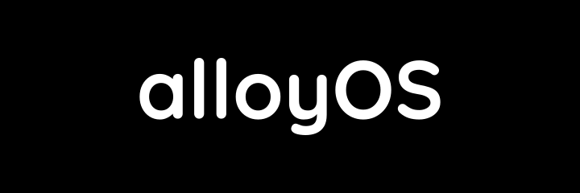

<p align="center">
  
</p>

# alloyOS

> **The desktop metaphor is dead weight. Stop bolting AI onto 1970s operating systems.**

**alloyOS** is an AI-first, bare-metal operating system written from scratch in `#![no_std]` Rust (`aarch64`, native `-accel hvf`). There is no POSIX baggage, no multi-user permission labyrinth, and no window manager cluttered with half-broken apps. It boots through a liquid-metal splash directly into **Ferrofluid (`ferrofluidd`)**—a display server driven entirely by a pluggable frontier model (**Gemini**, **Claude**, **ChatGPT**).

## The Manifesto

1. **No Filesystem Maze. No Shell.**
   Users shouldn't be system administrators, and AI agents shouldn't act through brittle string-piped shell commands (`sh`, `exec`, `spawn`). State lives in structured storage and typed capabilities. Neither the user nor the agent ever touches a raw shell.
2. **Zero Third-Party UI.**
   Every app shipping its own interface guarantees visual chaos, bloated binaries, and fragmented workflows. In **alloyOS**, third-party software is strictly headless. Developers ship pure capabilities—**Model Context Protocol (MCP)** endpoints and isolated `#![no_std]` JS tasks—never pixels.
3. **Agent-Exclusive Rendering.**
   Only the AI agent holds the capability token to paint surfaces in **Ferrofluid**. You never see inconsistent junk UI, dark patterns, or settings menus you didn't ask for. You see only what matters right now, synthesized by the agent in the highest-signal form possible.
4. **UI as Ferrofluid.**
   Interfaces should not be static windows nailed to a screen. Under the magnetic pull of intent, the interface coalesces on demand—forming tables, sparklines, controls, or prose—and dissolves back into obsidian the moment the task is done. The UI is molded like **ferrofluid**.

See **[ROADMAP.md](ROADMAP.md)** for the full architecture and milestone plan.

## User Knowledge (Planned)

The main agent will maintain a local Markdown repository under `/knowledge/`
to learn durable user facts, preferences, interests, and project context from
conversation. Entries track their source and scope, with inferred observations
kept separate from explicit statements. The user can inspect, correct, delete,
or pause learning.

Knowledge is user context; skills are supplied by applications under `/apps/`.
There is no separate `/skills/` directory or profile skill. See
[KNOWLEDGE.md](KNOWLEDGE.md) for the design and implementation sequence.
This is planned: the UI-to-agent bridge and persistent AI filesystem tools
must be connected before profile learning can work across reboots.

## Workspace Structure

| Crate | Description |
|---|---|
| [`crates/alloyos-kernel`](crates/alloyos-kernel) | Core `aarch64` kernel: ARMv8 MMU (`TTBR0_EL1`), `VBAR_EL1` exceptions, heap allocator, round-robin scheduler, syscalls (`svc #0`), PL011 UART, VirtIO-Blk/Net/GPU/Input, Hardware RNG, TCP/IP stack, VFS, and **CobaltFS** |
| [`crates/alloyos-boot`](crates/alloyos-boot) | Boot configuration, physical memory map validation, and **Liquid Metal Drip** metaball/surface-tension splash engine |
| [`crates/alloyos-proto`](crates/alloyos-proto) | Shared ABI/syscall definitions (`Socket`, `ShmGet`, `GetRandom`, `DirtyRect`, `InputEvent`) between kernel and userland |
| [`crates/alloyos-user`](crates/alloyos-user) | Userland standard library (`liballoy`), TLS 1.3 + HTTPS SSE streaming client, and bring-up console |
| [`crates/alloyos-ferrofluid`](crates/alloyos-ferrofluid) | **Ferrofluid System UI**: Slint window, bare-metal platform adapter, software rendering, Quicksand typography, and the agent capability gate |
| [`crates/alloyos-keyboard`](crates/alloyos-keyboard) | Reusable soft keyboard: transparent keys, tap feedback, slide/scroll behavior, typed actions, liquid displacement, and a standalone preview |
| [`crates/alloyos-js`](crates/alloyos-js) | Embedded `#![no_std]` JavaScript engine (`V8Isolate` / `JsRuntime`), `AlloyOS.*` bindings (zero shell access), and event/time scheduler (`scriptd`) |
| [`crates/alloyos-mcp`](crates/alloyos-mcp) | Headless **Model Context Protocol (MCP)** developer app SDK, zero-UI capability sandbox, and built-in MCP servers |
| [`crates/alloyos-forge`](crates/alloyos-forge) | Model gateway, resident Gemma inference, cloud provider adapters, and model selection |
| [`crates/alloyos-welder`](crates/alloyos-welder) | Agent orchestration, conversation and setup, shell-free native tools, persistent console configuration, and agent-exclusive UI synthesis |
| [`xtask`](xtask) | Build, QEMU (`-M virt -accel hvf`) runner, and headless E2E test harness |

## Filesystem

See **[FILESYSTEM.md](FILESYSTEM.md)** for the full directory hierarchy, seeded configuration files, and VFS interface details.

alloyOS uses a Virtual Filesystem Switch ([`vfs.rs`](crates/alloyos-kernel/src/fs/vfs.rs)) supporting:
- **[CobaltFS](crates/alloyos-kernel/src/fs/cobaltfs/README.md)** — Persistent on-disk filesystem based on the ext2 specification, implemented from scratch in Rust and backed by VirtIO-Blk.
- **RamFS** — In-memory filesystem for transient storage.
- **DevFS** — Device nodes (`/dev/tty`, `/dev/null`, `/dev/zero`, `/dev/serial`, `/dev/urandom`).

## Building & Running

Run the UI with resident Gemma using the root launcher:

```sh
./run.sh
# Or use a private token file for the first download:
./run.sh --auth-file /private/path/hf-token
```

In a terminal, the launcher guides you through build tools, optional Claude,
Gemini, or OpenAI API credentials, Gemma access, and launch. Pasted keys are
hidden; optional saved keys live in ignored `.secrets/` files with mode 600.
Forge uses configured keys for Claude, Gemini, and OpenAI through the QEMU
HTTPS bridge. In chat, select `/model claude`, `/model gemini`, or `/model openai`;
`/model local` returns to Gemma. Gemini is the default; saved model selections are preserved. Requests go to the
selected provider and may incur API charges. The launcher requires `curl` for
certificate-verified HTTPS.

For automation, use `./run.sh --non-interactive` (as the first option).
The launcher downloads and packages missing weights, then builds and runs in
release mode with 16 GiB guest RAM. Accept the Gemma license on Hugging Face
first; authentication defaults to the local `HF_TOKEN` environment variable.
Allow approximately 21 GB disk space. Subsequent launches reuse the model image.
See [scripts/README.md](scripts/README.md) for token storage and download details.

The graphical boot now opens **Ferrofluid System UI**, a Slint window with a
Ferrofluid-owned bare-metal adapter. See [its integration notes](crates/alloyos-ferrofluid/README.md)
for architecture, the host preview, and current limitations. Use `run --debug-shell`
for the serial bring-up shell; the existing shell E2E tests select it automatically.

Build the bootable `aarch64` kernel and launch in QEMU with native Apple Silicon HVF acceleration:

```bash
cargo run --package xtask -- run
```

Run the headless QEMU E2E test suite:

```bash
cargo run --package xtask -- test
```

Enable the repository's pre-push hook once per clone:

```sh
git config --local core.hooksPath .githooks
```

Every push runs `cargo run --package xtask -- ci`: all workspace tests (including
the keyboard UI tests), followed by the bare-metal build and headless QEMU E2E
suite. A failure blocks the upload. This requires the same Rust and QEMU setup
as the normal test suite.

UI screenshot tests compare committed PNG baselines and generate visual diffs
on failure. See [the screenshot test guide](tests/README.md) for running them
and explicitly reviewing baseline updates.
