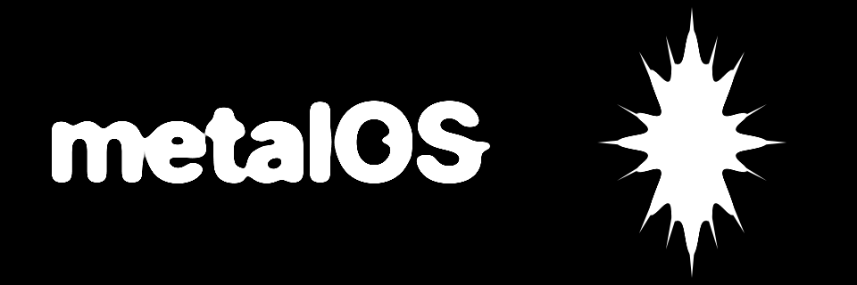

<p align="center">
  
</p>

# metalOS

**metalOS** is an AI-first, bare-metal operating system written in Rust (`#![no_std]`), built to run with native hardware virtualization (`-accel hvf`). It boots into **Mercury (`mercuryd`)**, a display server that initializes a user interface entirely driven by a pluggable model (**Gemini**, **Claude**, **ChatGPT**).

**metalOS** is lean by design: no file-system or shell access, no 3P graphic interfaces. Developers provide MCP-like endpoints, user only see what they want (no inconsistent junk UI), and the agent presents it in the best possible way. The UI is molded like **ferrofluid**.

See **[ROADMAP.md](ROADMAP.md)** for the full architecture and milestone plan.

## Workspace Structure

| Crate | Description |
|---|---|
| [`crates/metalos-kernel`](crates/metalos-kernel) | Core `aarch64` kernel: ARMv8 MMU (`TTBR0_EL1`), `VBAR_EL1` exceptions, heap allocator, round-robin scheduler, syscalls (`svc #0`), PL011 UART, VirtIO-Blk/Net/GPU/Input, Hardware RNG, TCP/IP stack, VFS, and **CobaltFS** |
| [`crates/metalos-boot`](crates/metalos-boot) | Boot configuration, physical memory map validation, and **Liquid Metal Drip** metaball/surface-tension splash engine |
| [`crates/metalos-proto`](crates/metalos-proto) | Shared ABI/syscall definitions (`Socket`, `ShmGet`, `GetRandom`, `DirtyRect`, `InputEvent`) between kernel and userland |
| [`crates/metalos-user`](crates/metalos-user) | Userland standard library (`libmetal`), TLS 1.3 + HTTPS SSE streaming client, and bring-up console |
| [`crates/metalos-mercury`](crates/metalos-mercury) | **Mercury (`mercuryd`)** GUI display server, double-buffered compositor, agent-exclusive UI security gate, and generative UI widgets |
| [`crates/metalos-js`](crates/metalos-js) | Embedded `#![no_std]` JavaScript engine (`V8Isolate` / `JsRuntime`), `MetalOS.*` bindings (zero shell access), and event/time scheduler (`scriptd`) |
| [`crates/metalos-mcp`](crates/metalos-mcp) | Headless **Model Context Protocol (MCP)** developer app SDK, zero-UI capability sandbox, and built-in MCP servers |
| [`crates/metalos-ai`](crates/metalos-ai) | Pluggable AI runtime (`Gemini`, `Claude`, `ChatGPT`), shell-free native OS tool registry, and agent-exclusive UI synthesizer |
| [`xtask`](xtask) | Build, QEMU (`-M virt -accel hvf`) runner, and headless E2E test harness |

## Filesystem

See **[FILESYSTEM.md](FILESYSTEM.md)** for the full directory hierarchy, seeded configuration files, and VFS interface details.

metalOS uses a Virtual Filesystem Switch ([`vfs.rs`](crates/metalos-kernel/src/fs/vfs.rs)) supporting:
- **[CobaltFS](crates/metalos-kernel/src/fs/cobaltfs/README.md)** — Persistent on-disk filesystem based on the ext2 specification, implemented from scratch in Rust and backed by VirtIO-Blk.
- **RamFS** — In-memory filesystem for transient storage.
- **DevFS** — Device nodes (`/dev/tty`, `/dev/null`, `/dev/zero`, `/dev/serial`, `/dev/urandom`).

## Building & Running

Build the bootable `aarch64` kernel and launch in QEMU with native Apple Silicon HVF acceleration:

```bash
cargo run --package xtask -- run
```

Run the headless QEMU E2E test suite:

```bash
cargo run --package xtask -- test
```
