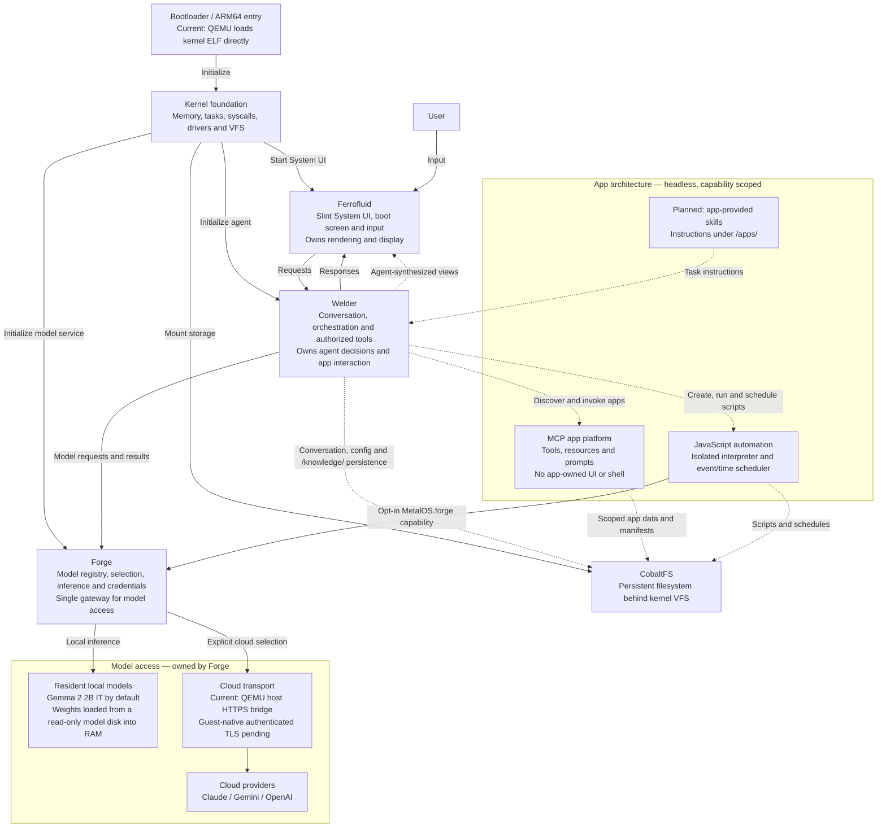

# metalOS Roadmap

**metalOS** is an AI-first, single-user, bare-metal ARM64 operating system written in `#![no_std]` Rust for QEMU `virt`, with native Apple Silicon acceleration through HVF. Ferrofluid provides the Slint system interface, Welder orchestrates the agent, Forge supplies resident and cloud model access, and CobaltFS provides persistent storage. Gemma 2 2B IT is the default local model; Claude, Gemini, and OpenAI are explicit cloud alternatives.

### Core Architectural Invariants
- **Single-User by Design**: Personal devices are single-owner devices. metalOS intentionally omits multi-user support (no UIDs/GIDs, user session switching, `/home/<user>` hierarchies, or cross-user permission matrices). Security and isolation boundaries exist strictly between **the AI Agent** and **capability-scoped JS isolates / headless MCP apps**, eliminating an entire class of state-synchronization and permission bugs.
- **No Shell for the AI**: The AI agent cannot see or execute shell commands (`sh`, `exec`, `spawn`). It interacts with the OS exclusively through typed native tools, local JavaScript (`metalos-js`), and MCP servers.
- **Agent-Exclusive UI**: Third-party developer apps are strictly headless MCP servers (`metalos-mcp`). Only the AI agent is permitted to create and update UI surfaces in **Ferrofluid (`ferrofluidd`)**.
- **Agent-Owned User Knowledge**: The planned knowledge service maintains local user context under `/knowledge/`, with source tracking and user correction/deletion controls. Skills are supplied by `/apps/`, independently of knowledge; no top-level `/skills/` directory is planned.

---

## Architecture Overview

The architecture centers on Welder as the agent, Forge as the model gateway,
Ferrofluid as the presentation layer, and CobaltFS as persistent storage.
Solid arrows show current relationships; dashed arrows show intended integrations
that are not yet connected end to end.

The current boot path uses the kernel's ARM64 entry code rather than a separate
bootloader executable. Ferrofluid owns the single system window; Welder supplies
chat responses and will direct agent-generated views. Apps expose capabilities
through MCP, and their results reach the user through Welder and Ferrofluid.
Forge owns both resident inference and cloud provider access; Welder does not
handle provider credentials or network transport.

CobaltFS is implemented, but Welder's tool filesystem currently uses an in-memory
map. Durable agent storage, live MCP/script wiring, app skills, and synthesized
Slint views remain pending. Local model weights currently use a separate read-only
model disk, rather than CobaltFS.

---

## Phase 1: ARM64 Boot, Kernel & CobaltFS

The kernel provides the hardware and storage foundation for the system. Its
ARM64 entry code establishes the execution environment, initializes memory and
drivers, and starts Ferrofluid, Forge, and Welder. CobaltFS provides persistent
disk storage through the kernel VFS; RamFS and DevFS provide volatile files and
device access. The current QEMU boot path loads the kernel ELF directly.

- [x] **ARM64 boot and hardware support**
  - EL2-to-EL1 entry, exception vectors, MMU mappings, PL011 serial and PSCI shutdown
  - QEMU `virt` support with Apple Silicon HVF acceleration
- [x] **Kernel services**
  - Heap and frame allocation, task scheduling, syscall dispatch and device drivers
  - Userland syscall wrappers in `metalos-user`; serial debug shell via `--debug-shell`
- [x] **Storage foundation**
  - VFS mount table, persistent CobaltFS, RamFS and DevFS
  - VirtIO block transport for filesystem disks
- [ ] **Agent storage integration**
  - Connect Welder's in-memory file tools and configuration to kernel VFS storage
  - Verify durable agent data across reboot and distinguish volatile fallback

---

## Phase 2: Networking & Authenticated Model Transport

The networking layer provides guest TCP/IP connectivity through VirtIO-Net and
smoltcp. Forge owns cloud API requests, credentials, and response parsing.
Cloud model access currently uses a bounded UART capability to a QEMU host
relay, which performs certificate-verified HTTPS. Guest-native authenticated
TLS remains a separate integration requirement.

- [x] **Guest network foundation**
  - VirtIO-Net transport, smoltcp stack and socket syscalls
  - DNS support and hardware RNG/CSPRNG exposed through `/dev/urandom`
- [x] **Forge cloud HTTPS capability**
  - Fixed provider destinations, bounded UART frames and host `curl` certificate verification
  - Cooperative transport polling keeps input and rendering active during cloud requests
  - Credentials enter volatile guest memory through fw_cfg; Welder receives text or sanitized errors
- [x] **Networking protocol libraries**
  - HTTP parsing, chunked transfer/SSE helpers and TLS-related primitives in `metalos-user`
- [ ] **Guest-native authenticated HTTPS**
  - Complete and validate TLS handshake, certificate authentication and encrypted transport
  - Connect Forge to native HTTPS without requiring the QEMU host relay
- [ ] **Live response streaming**
  - Deliver incremental model output through Forge, Welder and Ferrofluid
  - Current cloud replies are delivered as complete responses

---

## Phase 3: Boot Presentation & Model Readiness

Boot presentation makes system startup visible while storage and model services
initialize. Ferrofluid displays a metalOS logotype with liquid turbulence in the same Slint
window that becomes the workspace. Forge loads local model weights from a
read-only VirtIO model disk into reserved guest RAM while the boot UI remains
active, then signals completion or reports a loading error.

- [x] **Early boot display**
  - VirtIO-GPU scanout and Slint boot logotype with liquid turbulence before model weight reads
  - Shared window for boot presentation and the interactive workspace
- [x] **Model loading and transition**
  - Polled DMA transfers into reserved RAM without a whole-image ROM preload
  - Resident backend attachment, readiness/error reporting and workspace transition
- [x] **Liquid animation library**
  - Metaball and mercury shading helpers in `metalos-boot`
  - The active boot screen applies layered turbulence to the Slint logotype
- [x] **Boot logo turbulence**
  - Subtle layered displacement and bilinear sampling preserve smooth text edges
  - White droplets stretch from glyph edges, detach and fall during loading
  - Repaint the logo region while loading and stop the effect on workspace transition

---

## Phase 4: Ferrofluid System UI & Native Input

Ferrofluid owns the single fullscreen Slint System UI, its bare-metal platform
adapter, and rendering. The kernel supplies input, monotonic time, and GPU
scanout. Ferrofluid forwards user submissions to Welder and presents replies
and model selection. The independent `metalos-keyboard` component supplies the
soft keyboard and liquid displacement effects.

- [x] **Slint platform and rendering**
  - Software rendering, damage tracking, embedded Quicksand font and Fluent dark controls
  - All Slint operations remain on the boot/UI execution context
- [x] **Conversation and keyboard input**
  - Conversation viewport, text editing, submission and soft keyboard
  - Welder request/reply bridge, active model display and pending-reply state
- [x] **Agent UI authorization**
  - Capability gate rejects app-owned UI and invalid agent credentials
- [ ] **Agent-generated views**
  - Render Welder's synthesized views as Slint controls and route interactions back to the agent
- [ ] **Interrupt-driven wakeups**
  - Replace the current input/timer loop, which polls at up to 60 Hz
- [ ] **Voice input**
  - Microphone capture and speech-to-text into the focused editor
  - Start/stop controls and recording/transcription status

---

## Phase 5: Welder Agent & Forge Model Access

Welder owns conversation, orchestration, authorized tool use, and app interaction.
Forge is its model gateway: it owns model discovery and selection, resident
inference, cloud adapters, credentials, and provider transport. Gemma 2 2B IT is
the resident default; cloud models require configured access and explicit
selection. Missing backends and failed requests return errors without silently
switching providers. The planned default model selection is **Auto**, which
prefers local inference and routes more complex tasks to configured cloud models.

- [x] **Forge resident inference**
  - Multi-model registry, bounded requests and resident backend lifecycle
  - Gemma2 F32/F16 GGUF CPU backend with weights retained in guest RAM
  - Local generation is synchronous; unsupported tensor encodings fail explicitly
- [x] **Forge cloud adapters**
  - Claude Messages, Gemini GenerateContent and OpenAI Responses
  - `/model local`, `/model claude`, `/model gemini` and `/model openai` selection
  - Credentials and network transport remain inside Forge's access boundary
- [x] **Welder runtime libraries**
  - `AgentRuntime` connects the graphical console to Forge and manages conversation and tool dispatch
  - Separate bounded `Welder` model/tool loop with routing policy and tool authorization
  - Native tool interfaces for files, status, scripts, MCP and agent UI synthesis
- [x] **Development access and model packaging**
  - Versioned Forge UART protocol and optional loopback inference endpoint
  - Host download/image packaging, authentication references and model-sized guest memory
- [ ] **Complete console agent integration**
  - Connect the graphical console to the bounded multi-step tool loop and real OS/app capabilities
  - Persist configuration, conversation and first-boot preferences on CobaltFS
- [ ] **Auto model selection by default**
  - Make `Auto` the default model option in Ferrofluid and persist it in the agent configuration
  - Automatically assess task complexity and required capabilities; prefer a ready local model for tasks it can handle and select a configured cloud model for more complex tasks
  - Keep routing in Forge, driven by Welder's task requirements, and preserve manual model selection as an override
  - Show which model Auto selected and respect configured cloud access; report unavailable models rather than treating request failures as task complexity
- [ ] **Full-model acceptance and performance**
  - Verify readiness and generation with official Gemma weights in the target guest
  - Library fixtures establish interface and numeric behavior, not full-model acceptance

---

## Phase 6: JavaScript Automation & Scheduling

`metalos-js` provides a custom `no_std` JavaScript interpreter for local automation.
Each isolate has deterministic execution limits and capability-scoped host
bindings. The scheduler supports time and event triggers; scripts can access
Forge only through an explicitly granted `MetalOS.forge(...)` capability.

- [x] **Interpreter and host API**
  - Parsing, isolated execution and instruction fuel limits
  - `MetalOS.*` interfaces for files, network, status and notifications; shell access is forbidden
  - `V8Isolate` is a compatibility alias for the custom interpreter
- [x] **Scheduling library**
  - One-shot timers, intervals, five-field cron expressions and event matching
  - Schedule serialization and host-backed save/load interfaces
  - Kernel boot dispatches the system boot event
- [ ] **Live automation integration**
  - Connect Welder script tools to interpreter execution and the scheduler
  - Wire ongoing kernel time, filesystem, network and lifecycle events
  - Supply real capability-scoped OS host bindings in place of virtual host data
- [ ] **Durable scripts and schedules**
  - Store `/scripts/*.js` and `/etc/schedules.conf` through CobaltFS
  - Restore and verify automations across reboot

---

## Phase 7: Headless MCP Apps & Agent Presentation

Developer apps expose tools, resources, and prompts through MCP. Welder discovers
and invokes these capabilities and determines how their results are presented
through Ferrofluid. App manifests define permitted storage and network access;
apps cannot own windows, capture raw input, access the framebuffer, or execute
shell commands. App-provided skills supply task instructions separately from
capability authorization and user knowledge.

- [x] **MCP platform library**
  - JSON-RPC protocol, app registry and `/apps/*.mcp` manifest discovery interfaces
  - Built-in NotesVault, TaskBoard and SysPulse apps registered at boot
- [x] **Capability enforcement**
  - Manifest validation and runtime guards reject UI, raw-input and shell capabilities
  - Scoped storage and network capability declarations
- [x] **Agent presentation library**
  - Welder synthesizes structured views from tool results with agent authorization
- [ ] **Live app broker**
  - Connect Welder's current in-memory MCP tool data to the registered app transport
  - Enforce scoped access against real OS storage and networking
- [ ] **App-provided skills**
  - Discover instructions under `/apps/`; treat skill text as untrusted context
  - Keep tool authorization separate from discovery and instructions
- [ ] **Ferrofluid view integration**
  - Present synthesized app views and controls in Slint through Welder

---

## Phase 8: Local User Knowledge & Profile Learning

Welder's planned knowledge service maintains durable user context as Markdown
under `/knowledge/` on CobaltFS. It distinguishes explicit facts and preferences
from tentative observations, records sources, and retrieves only relevant
context. User controls provide inspection, correction, deletion, and paused
learning. See [KNOWLEDGE.md](KNOWLEDGE.md) for the design.

- [ ] **Persistent knowledge storage**
  - Validate updates, protect interrupted writes and verify records across reboot
  - Distinguish durable CobaltFS storage from volatile RamFS fallback
- [ ] **Conversation-driven learning**
  - Extract and merge durable information after relevant agent turns
  - Track sources and timestamps; separate inference from explicit statements
- [ ] **Bounded retrieval and tools**
  - `knowledge_search`, `knowledge_upsert` and `knowledge_forget`
  - Compact summary plus relevant retrieval; stored context remains data
- [ ] **User controls and app boundaries**
  - Inspect, correct, delete and pause learning through Ferrofluid
  - Remove forgotten records from summaries and retrieval
  - Apps supply context through Welder; they cannot freely rewrite the profile
  - Share only relevant context needed for model requests

---

## Milestone Summary

| Milestone | Deliverable | Target Crate(s) | Status |
|---|---|---|---|
| **M1: ARM64 Core & CobaltFS** | Boot entry, kernel services, VFS and persistent storage | `metalos-kernel`, `metalos-user` | Foundation implemented; agent persistence pending |
| **M2: Networking & Model Transport** | Guest TCP/IP and authenticated Forge cloud access | `metalos-kernel`, `metalos-user`, `metalos-dev-harness` | Host HTTPS bridge implemented; native TLS and streaming pending |
| **M3: Boot & Model Readiness** | Liquid boot logo, resident weight loading and workspace transition | `metalos-boot`, `metalos-kernel`, `metalos-ferrofluid` | Logo turbulence and loading implemented |
| **M4: Ferrofluid System UI** | Slint rendering, chat bridge and native input | `metalos-ferrofluid`, `metalos-keyboard`, `metalos-kernel` | Chat and keyboard connected; synthesized views, IRQ wakeups and voice pending |
| **M5: Welder & Forge** | Agent orchestration, resident inference and cloud adapters | `metalos-welder`, `metalos-forge` | Runtime libraries and model access implemented; default Auto routing, complete agent integration and full-model acceptance pending |
| **M6: JS Automation** | Capability-scoped interpreter and time/event scheduler | `metalos-js`, `metalos-welder` | Libraries implemented; live OS wiring and durability pending |
| **M7: MCP Apps** | Headless app platform, scoped capabilities and agent presentation | `metalos-mcp`, `metalos-welder`, `metalos-ferrofluid` | Core libraries implemented; live broker, app skills and view transport pending |
| **M8: User Knowledge** | Durable profile, retrieval, learning and user controls | `metalos-welder`, `metalos-kernel`, `metalos-ferrofluid` | Planned |
