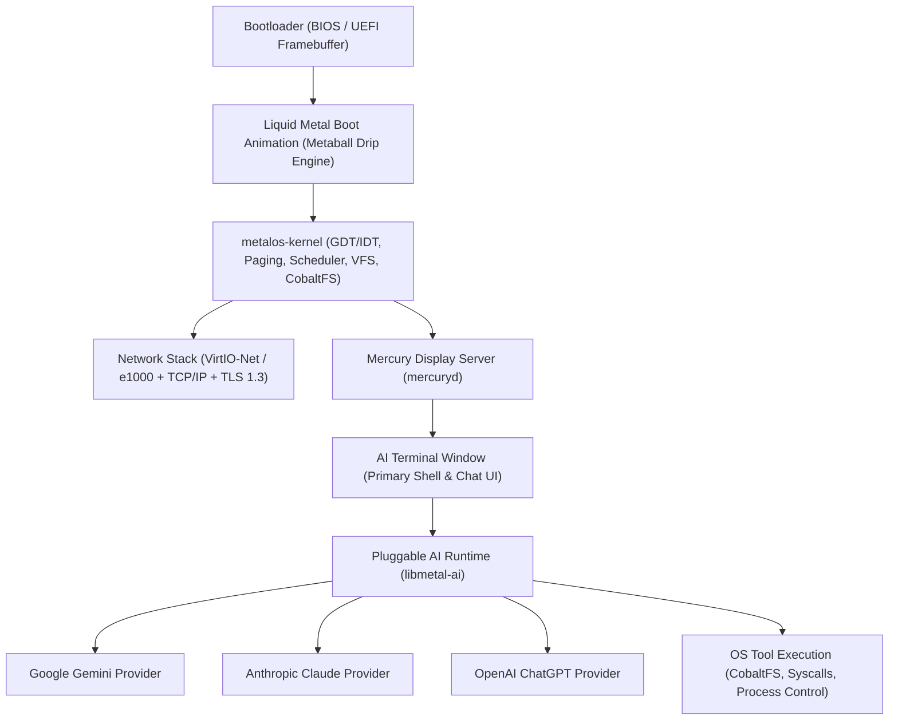

# metalOS Roadmap

**metalOS** is an AI-first, bare-metal `x86_64` operating system written in `#![no_std]` Rust. Rather than bolting AI onto a legacy desktop metaphor, metalOS boots through a liquid-metal splash animation directly into **Mercury (`mercuryd`)**—a lightweight display server initialized with a single terminal-style AI chat window backed by pluggable frontier models (**Gemini**, **Claude**, **ChatGPT**).

---

## Architecture Overview



---

## Phase 1: Bare-Bones Kernel, Storage & CLI Shell (Foundation)

The foundational kernel, persistent storage engine, and command-line environment.

- [x] **Core `x86_64` Kernel (`crates/metalos-kernel`)**
  - GDT, IDT, PIC interrupt handling, and PIT timer interrupts
  - 4-level page table management and kernel heap allocator
  - Cooperative/preemptive round-robin task scheduler
  - Ring-3 userland transition and syscall ABI (`crates/metalos-proto`)
- [x] **Virtual Filesystem & Storage**
  - VFS switch (`crates/metalos-kernel/src/fs/vfs.rs`) with mount table
  - **CobaltFS** (`crates/metalos-kernel/src/fs/cobaltfs`): persistent ext2-inspired disk filesystem over ATA PIO (`crates/metalos-kernel/src/drivers/ata.rs`)
  - **RamFS** and **DevFS** (`/dev/null`, `/dev/zero`, `/dev/serial`)
- [x] **Userland Standard Library & CLI (`crates/metalos-user`)**
  - `libmetal` syscall wrappers, file I/O, and process management
  - Interactive command-line shell (`sh`) with built-in utilities (`ls`, `cat`, `echo`, `mkdir`, `rm`, `stat`, `write`)
- [x] **Build & Verification Harness (`xtask`)**
  - Bootable disk image builder and headless QEMU E2E test suite
- [ ] **PS/2 Keyboard & Framebuffer Console**
  - Local PS/2 keyboard scancode driver (complementing `/dev/serial`)
  - Early linear framebuffer text console for standalone non-serial CLI use

---

## Phase 2: Networking Stack & HTTPS Client

To communicate directly with cloud LLM APIs (Gemini, Claude, ChatGPT) from bare metal, metalOS requires a full network and cryptographic stack.

- [ ] **PCI Bus Enumeration & NIC Drivers**
  - PCI configuration space scanner in `crates/metalos-kernel/src/drivers/pci.rs`
  - **VirtIO-Net** driver (primary for QEMU/KVM) and Intel **e1000** fallback
- [ ] **TCP/IP Stack Integration**
  - Integrate `smoltcp` in `#![no_std]` kernel/daemon space (`ARP`, `IPv4`, `ICMP`, `UDP`, `DHCP`, `TCP`, `DNS`)
  - Expose socket syscalls (`SYS_SOCKET`, `SYS_CONNECT`, `SYS_SEND`, `SYS_RECV`, `SYS_CLOSE`) in `crates/metalos-proto`
- [ ] **Hardware RNG & TLS 1.3**
  - `RDRAND` / `RDSEED` hardware entropy source + `/dev/urandom` device node
  - `#![no_std]` TLS 1.3 client (`embedded-tls` or `rustls` no_std port) with embedded root CA bundle stored on CobaltFS (`/etc/ssl/certs.pem`)
- [ ] **HTTP/1.1 & Server-Sent Events (SSE) Client**
  - Streaming HTTPS client in `crates/metalos-user` capable of chunked transfer encoding and SSE token streaming for real-time LLM responses

---

## Phase 3: Boot Splash & Liquid Metal Drip Animation

During boot, before transitioning into the interactive workspace, metalOS renders a signature **Liquid Metal Drip** animation based on `assets/logo.svg`.

- [ ] **Linear Framebuffer Setup (`crates/metalos-boot` & `crates/metalos-kernel`)**
  - Configure `bootloader` to negotiate a high-resolution 32-bpp VESA/GOP linear framebuffer (e.g., `1280x800` or `1920x1080`)
  - Double-buffered framebuffer driver with fast page-flipping / damage blitting
- [ ] **2D Metaball & Surface-Tension Scalar Field Engine**
  - Recreate the `crystal-weld` and `mercury-type` SVG filter physics (`feGaussianBlur` + high-contrast alpha thresholding `28*a - 11`) in a real-time `#![no_std]` software/SIMD shader
  - Render the **metalOS** viscous meniscus wordmark and **Ferrofluid Crystal Emblem** on a pure `#000000` canvas
- [ ] **Viscous Drip Physics During Kernel Init**
  - Animate molten mercury droplets detaching from the bottom meniscus bridges of the `metalOS` typography and ferrofluid spikes, stretching under simulated gravity and surface tension before coalescing into the initial **Mercury** terminal window border

---

## Phase 4: Mercury (`mercuryd`) — GUI Display Server & Compositor

**Mercury (`mercuryd`)** is the display server and window compositor for metalOS. It initializes directly into a single, distraction-free, terminal-like window that serves as the AI chat interface.

- [ ] **Mercury Display Server Core (`crates/metalos-mercury` / `mercuryd`)**
  - Manages the hardware framebuffer, dirty-rectangle damage tracking, and vsync pacing
  - Input event multiplexing from PS/2 keyboard, PS/2 mouse, and VirtIO-Input devices
  - Lightweight IPC protocol over shared memory rings (`SYS_SHM` / IPC channels) for window surfaces and input events
- [ ] **Mercury Aesthetic & Rendering Primitives**
  - Crisp monochrome & liquid-mercury visual language (deep obsidian `#000000`/`#0A0A0C` background, specular silver/chrome borders, anti-aliased bitmap/SDF monospace typography)
  - Smooth cursor rendering, scrollback viewport, and markdown/code-block formatting inside the terminal surface
- [ ] **Single-Window AI Boot Mode**
  - On startup, `mercuryd` transitions seamlessly from the boot drip animation into a single centered (or fullscreen) terminal-like window—the **Mercury AI Console**

---

## Phase 5: AI-First Shell & Pluggable Model Runtime

Instead of a traditional POSIX shell as the primary human interface, the initial Mercury window is a conversational AI terminal that both chats with the user and acts as an autonomous OS operator.

- [ ] **Pluggable Provider Trait (`libmetal-ai`)**
  - Unified `AiModelProvider` interface supporting streaming token generation, conversation history, system prompts, and tool/function calling:
    ```rust
    pub trait AiModelProvider {
        fn name(&self) -> &'static str;
        fn stream_chat(
            &mut self,
            messages: &[Message],
            tools: &[ToolSpec],
            on_token: &mut dyn FnMut(&str),
        ) -> Result<Response, AiError>;
    }
    ```
- [ ] **First-Class Model Adapters**
  - **Gemini Provider**: Google Gemini API (`generateContent` / `streamGenerateContent` over SSE)
  - **Claude Provider**: Anthropic Messages API (`/v1/messages` with streaming SSE)
  - **ChatGPT Provider**: OpenAI Chat Completions / Responses API (`/v1/chat/completions` with streaming SSE)
  - Runtime hot-swapping via slash commands (`/model gemini`, `/model claude`, `/model chatgpt`) and persistent config in CobaltFS (`/etc/ai.conf`)
- [ ] **Native OS Tool-Use & Shell Fusion**
  - Equip the AI terminal with native metalOS capabilities so natural language commands can inspect and mutate the system safely:
    - `fs_read` / `fs_write` / `fs_list` (direct CobaltFS & VFS operations)
    - `sh_exec` (run underlying `sh` commands and stream stdout/stderr inline in the chat window)
    - `sys_status` (inspect memory allocation, active tasks, network interfaces, and uptime)
  - Dual-mode input: type natural language to talk to the active AI model, or prefix with `!` (e.g., `!ls /`) to execute raw shell commands directly.

---

## Milestone Summary

| Milestone | Deliverable | Target Crate(s) | Status |
|---|---|---|---|
| **M1: Bare-Metal CLI** | Kernel, CobaltFS, VFS, `libmetal`, interactive `sh` | `metalos-kernel`, `metalos-user` | Complete (Serial CLI) |
| **M2: Connected Metal** | VirtIO-Net, TCP/IP, DNS, TLS 1.3, HTTPS SSE client | `metalos-kernel`, `metalos-user` | Planned |
| **M3: Liquid Boot** | High-res framebuffer + dripping liquid-metal logo animation | `metalos-boot`, `metalos-kernel` | Planned |
| **M4: Mercury GUI (`mercuryd`)** | Display server booting into single terminal-style window | `metalos-mercury`, `metalos-kernel` | Planned |
| **M5: Pluggable AI OS** | Gemini, Claude & ChatGPT providers + native OS tool execution | `metalos-ai`, `metalos-user` | Planned |
