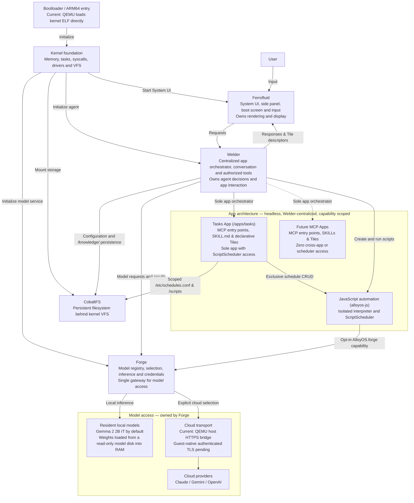

# alloyOS Roadmap

**alloyOS** is an AI-first, single-user, bare-metal ARM64 operating system written in Rust for QEMU `virt`, with native Apple Silicon acceleration through HVF. Ferrofluid provides the Slint system interface, Welder orchestrates the agent, Forge supplies resident and cloud model access, and CobaltFS provides persistent storage. Gemma 2 2B IT is the default local model; Claude, Gemini, and OpenAI are explicit cloud alternatives.

## Top Next Priority: Connect Web-Hosted MCP Servers

Deliver a user-initiated external MCP connection end to end, with Gmail as the
first acceptance target. This comes before protected Welder/setup separation and
the remaining feature work below. Choose a hosted Gmail provider only after its
actual transport, OAuth flow and tool contract are verified; Smithery is an
optional discovery adapter, not a required provider or runtime dependency.

- [ ] **Discover compatible hosted endpoints.** Accept direct endpoint setup and
  optional official MCP Registry/Smithery adapters behind the same connection
  contract. Registry metadata identifies hosted endpoint candidates; it does not
  prove connectivity. Verify the MCP handshake and tools before reporting a
  connection ready. Do not offer localhost,
  local stdio, npm/Node/Python launch commands or MCPB server execution. Native
  capability-scoped alloyOS JavaScript app packages use our MCP SDK and require
  no additional binaries or frameworks.
- [ ] **Separate install, authorization and readiness.** Explain the selected
  service and obtain explicit installation approval; retain installed connection
  configuration without claiming that installation or discovery connects an
  account. Expose authorization-needed, connecting, ready and actionable error
  states, with retry and disconnect.
- [ ] **Finish production transport and account handling.** Add cooperative
  request polling, bounded headers/messages, authenticated requests, MCP session
  lifecycle and verified `initialize`, `tools/list` and `tools/call` behavior.
  Provide a secure OAuth/token lifecycle, refresh and revocation, persisting only
  appropriate configuration and protected token references. Keep credentials out
  of model context, normal logs and app-facing presentation.
- [ ] **Pass hosted Gmail acceptance.** Discover or select a compatible hosted
  endpoint → approve installation → authorize the account through OAuth → verify
  `initialize` and `tools/list` → read/search authorized Gmail through an actual
  tool call. Verify denial/error recovery, disconnect/revoke, and restoration of
  installed configuration/token references after reboot. Conversation history
  remains session-only. No account connection or Gmail action has been executed
  as part of current fixture validation.

Completed gates cover native Install/Cancel consent, fail-closed platform entropy,
public hosted MCP discovery/tool calls, and a three-boot synthetic OAuth flow
through the OS broker and CobaltFS private store, including refresh and durable
local disconnect after provider failure. Committed native client-profile setup
adds explicit Review/Save/Cancel, private app-and-endpoint-bound registration,
and private registration cleanup before approved package removal. Synthetic UI,
broker and filesystem tests cover these paths; saving registration configuration
does not authorize an account or verify a real provider registration.
Credentials are unencrypted at rest;
optional QEMU browser assistance stores no credentials, while the development
HTTPS relay can transiently see protected request plaintext. Provider selection,
real provider client registration and real Gmail authorization remain unverified.
The OS owns account state and credentials; app packages only identify the remote
resource and request scoped access through the OS broker.

Existing public-registry search, remote package install/uninstall and remote MCP
fixtures are foundations, not proof of production account connectivity. Optional
conversational app onboarding during first-run setup remains deferred; it is
separate from this immediate user-initiated connection priority.

### Core Architectural Invariants
- **Single-User by Design**: Personal devices are single-owner devices. alloyOS intentionally omits multi-user support (no UIDs/GIDs, user session switching, `/home/<user>` hierarchies, or cross-user permission matrices). Security and isolation boundaries exist strictly between **the AI Agent** and **capability-scoped JS isolates / headless MCP apps**, eliminating an entire class of state-synchronization and permission bugs.
- **No Shell for the AI**: The AI agent cannot see or execute shell commands (`sh`, `exec`, `spawn`). It interacts with the OS exclusively through typed native tools, local JavaScript (`alloyos-js`), and MCP servers.
- **Agent-Exclusive UI & Declarative Tiles**: Developer apps are strictly headless (`alloyos-mcp`) and never link against or depend on any UI toolkit. Each app can expose **MCP entry points** (tools, resources, prompts), **SKILLs** (text files under `/apps/<app_id>/SKILL.md`), and declarative **Tiles** (`AppTile` schemas that can be embedded in the chat stream or pinned to the **side panel**). Only Welder and **Ferrofluid (`ferrofluidd`)** synthesize and render UI surfaces.
- **One Process per App**: Every JavaScript app runs in its own independently scheduled OS process with a private virtual address space. `alloyos-mcp` invokes app handlers through IPC; manifest capabilities remain enforced inside each app process. An app fault or hang must not stop the host, Welder, Ferrofluid, or other apps.
- **Web-Hosted External MCP Servers**: External MCP discovery and installation offer only servers with a verified web-hosted endpoint. Local-only stdio, Node/Python launch commands and MCPB bundles are outside the supported external-server model. Capability-scoped alloyOS JavaScript app packages remain a separate native app architecture.
- **Userland Runtime Direction**: Keep the kernel `no_std`; support Rust `std` and targeted native-library compatibility in selected protected userland services. This runtime is planned, not implemented. Apps remain headless and capability-scoped regardless of their implementation runtime.
- **Ferrofluid-Owned Web Presentation**: Ferrofluid alone owns website presentation and browser controls. Welder requests navigation through typed system capabilities; apps cannot supply HTML, page JavaScript, or arbitrary pixel surfaces. An isolated browser service executes web content on Ferrofluid's behalf without inheriting app, MCP, or knowledge access.
- **Protected Display Server**: Ferrofluid runs as a separate EL0 process with a private address space and its own executable. Kernel drivers retain hardware ownership and expose bounded input, time, and presentation interfaces. Ferrofluid supports separate executable packaging and restart. The early boot splash comes from an isolated cached asset; Ferrofluid remains a kernel test dependency only. Welder and Forge currently remain in the kernel host. Independent Welder/setup builds are planned under Phase 5; Forge, drivers, VFS, and networking retain their current placement for that increment.
- **Welder-Centralized App Orchestration & Capability-Based Scheduler Access**: No app can access or invoke another app; **only Welder centralizes app access and orchestration**. Apps declare `ScriptSchedulerAccess` in their filesystem manifests to receive scheduler bindings and storage scopes. Rust OS services do not select applications by name.
- **Agent-Owned User Knowledge**: Welder's knowledge service maintains local user context under `/knowledge/`, with source tracking and user correction/deletion controls. Skills are supplied by `/apps/`, independently of knowledge; no top-level `/skills/` directory is planned.

---

## Architecture Overview

The architecture centers on Welder as the agent, Forge as the model gateway,
Ferrofluid as the presentation layer, and CobaltFS as persistent storage.
Solid arrows show current relationships; dashed arrows show intended integrations
that are not yet connected end to end.

The current boot path uses the kernel's ARM64 entry code rather than a separate
bootloader executable. Ferrofluid owns the single system window; Welder supplies
chat responses and directs agent-generated views and declarative App Tiles. Each
app can expose MCP entry points, SKILL text files (`/apps/<app_id>/SKILL.md`),
and UI-agnostic Tiles (`AppTile`) that can be embedded in the conversation
stream or pinned to the **side panel**. No app can access another app — only
Welder centralizes app orchestration — and `Tasks` is the sole app allowed to
access `ScriptScheduler`.

These component relationships now cross protected process boundaries: Ferrofluid
is loaded from `/system/ferrofluid` into a private EL0 address space, and JavaScript
MCP handlers execute in private app processes using `/bin/app-runner`. Welder,
Forge, filesystem/network services and hardware drivers remain in the kernel host.
The QEMU bootloader is a startup stage, not a concurrent process.

Ferrofluid code, Slint UI, fonts and assets are separately packaged with
`cargo xtask processes --release`. This path skips the guest kernel build and
uses the shared `alloyos-fs` library for CobaltFS image packaging. Neither xtask
nor the kernel build script imports Ferrofluid; the latter reads the isolated
boot-wordmark asset. Welder/setup executable separation remains pending.
The shared display IPC schema is an ABI: changing it requires rebuilding both ends.

---

## Phase 1: ARM64 Boot, Kernel & CobaltFS

The kernel provides the hardware and storage foundation for the system. Its
ARM64 entry code establishes the execution environment, initializes memory and
drivers, and starts Ferrofluid, Forge, and Welder. CobaltFS provides persistent
disk storage through the kernel VFS; RamFS and DevFS provide volatile files and
device access. The current QEMU boot path loads the kernel ELF directly.

- [x] **ARM64 boot and hardware support**
  - EL2-to-EL1 entry, exception vectors, MMU mappings, PL011 serial and PSCI shutdown
  - QEMU `virt` support with Apple Silicon HVF acceleration
- [x] **Kernel services**
  - Heap and frame allocation, task scheduling, syscall dispatch and device drivers
  - Userland syscall wrappers in `alloyos-user`; serial debug shell via `--debug-shell`
- [x] **Shared protected-process foundation**
  - Static AArch64 ELF loading from CobaltFS with validated entry/segments, W^X permissions, zeroed BSS, inaccessible gaps and private heap/stack pages across multiple leaf tables
  - Real EL0 entry/return, address-space switching, FP/SIMD context preservation and timer preemption
  - Validated copy-in/out, restricted syscalls, supervisor-derived caller identity, bounded IPC and role-specific host operations; protected processes cannot access shared descriptors, kernel memory or peers
  - Fallible private-memory allocation, execution deadlines, fault/exit/cancellation cleanup and independently packaged executables
  - Low-level guest gates: `python3 scripts/test-process-isolation.py` (GICv2/GICv3); complete runtime gates: `python3 scripts/test-process-runtime.py`
  - Current IPC polls bounded queues; general-purpose blocking IPC and arbitrary POSIX executable hosting remain future work
- [x] **Storage foundation**
  - VFS mount table, persistent CobaltFS, RamFS and DevFS
  - VirtIO block transport for filesystem disks
- [ ] **Agent storage integration**
  - File tools, configuration, setup and knowledge use kernel VFS storage
  - Verify durable agent data across reboot and distinguish volatile fallback; conversation history is session-only and is not restored after reboot

---

## Phase 2: Networking & Authenticated Model Transport

The networking layer provides guest TCP/IP connectivity through VirtIO-Net and
smoltcp. Forge owns cloud API requests, credentials, and response parsing.
Cloud model access currently uses a bounded UART capability to a QEMU host
relay, which performs certificate-verified HTTPS. Guest-native authenticated
TLS remains a separate integration requirement.

- [x] **Guest network foundation**
  - VirtIO-Net transport, smoltcp stack and socket syscalls
  - DNS support and hardware RNG/CSPRNG exposed through `/dev/urandom`
- [x] **Forge cloud HTTPS capability**
  - Fixed provider destinations, bounded UART frames and host `curl` certificate verification
  - Cooperative transport polling keeps input and rendering active during cloud requests
  - Credentials enter volatile guest memory through fw_cfg; Welder receives text or sanitized errors
- [x] **Networking protocol libraries**
  - HTTP parsing, chunked transfer/SSE helpers and TLS-related primitives in `alloyos-user`
- [x] **Guest-native authenticated HTTPS**
  - Complete and validate TLS handshake, certificate authentication and encrypted transport
  - Connect Forge to native HTTPS without requiring the QEMU host relay
- [x] **Live response streaming**
  - Deliver incremental model output through Forge, Welder and Ferrofluid
  - Cloud SSE and local generation replies stream incrementally into the UI

---

## Phase 3: Boot Presentation & Model Readiness

Boot presentation makes system startup visible while storage and model services
initialize. Ferrofluid displays a alloyOS logotype with liquid turbulence in the same Slint
window that becomes the workspace. Forge loads local model weights from a
read-only VirtIO model disk into reserved guest RAM while the boot UI remains
active, then signals completion or reports a loading error.

- [x] **Early boot display**
  - VirtIO-GPU scanout and Slint boot logotype with liquid turbulence before model weight reads
  - Shared window for boot presentation and the interactive workspace
- [x] **Model loading and transition**
  - Polled DMA transfers into reserved RAM without a whole-image ROM preload
  - Resident backend attachment, readiness/error reporting and workspace transition
- [x] **Liquid animation library**
  - Metaball and mercury shading helpers in `alloyos-boot`
  - The active boot screen applies layered turbulence to the Slint logotype
- [x] **Boot logo turbulence**
  - Subtle layered displacement and bilinear sampling preserve smooth text edges
  - White droplets stretch from glyph edges, detach and fall during loading
  - Repaint the logo region while loading and stop the effect on workspace transition

---

## Phase 4: Ferrofluid System UI, side panel & Native Input

Ferrofluid owns the single fullscreen System UI, its bare-metal platform
adapter, and rendering. The kernel supplies input, monotonic time, and GPU
scanout. Ferrofluid forwards user submissions to Welder and presents replies
and model selection. The independent `alloyos-keyboard` component supplies the
soft keyboard and liquid displacement effects.

- [x] **Platform and rendering**
  - Software rendering, damage tracking, embedded Quicksand font and Fluent dark controls
  - All Slint operations run on the protected display process’s UI thread
- [x] **Independent protected Ferrofluid display server**
  - Standalone `/system/ferrofluid` ELF owns Slint, UI assets, input interpretation and rendering in a private EL0 process; Ferrofluid/Slint are absent from kernel runtime/build dependencies and remain kernel test dependencies only
  - Kernel drivers retain GPU/input hardware ownership; only the authorized display PID can poll input or present validated fixed-size frames
  - Bounded host/display IPC carries submissions, incremental replies, model state, conversation items, tiles, tile actions and side panel pins
  - Authoritative conversation/side panel state stays in the host; display faults and expired execution leases trigger restart with bounded retry/backoff and restored presentation state
  - `/display restart` reloads Ferrofluid without rebooting; applied-state ACKs verify restored conversation/pin content. Kernel-owned startup bars remain visible until Ferrofluid renders its boot/workspace UI
  - `cargo xtask processes --release` rebuilds and updates packaged executables through kernel-free image tools. CobaltFS development-volume upgrades preserve files and retain an original backup with rollback on packaging failure
  - Runtime guest acceptance covers actual EL0 display fault, restart and restored conversation/side panel state; normal graphical input and unchanged-kernel rebuild are separate verification gates
- [x] **Conversation and keyboard input**
  - Conversation viewport, text editing, submission and soft keyboard
  - Welder request/reply bridge, active model display and pending-reply state
- [x] **Agent UI authorization**
  - Capability gate rejects app-owned UI and invalid agent credentials
- [ ] **Side panel and pinned Tiles**
  - Hosts dynamic, live-updating **Tiles** pinned from installed apps (such as `tasks.board` from `Tasks`)
  - Pin/unpin/order state, persistent pin preferences and periodic refresh for pinned Tiles
  - Available Tiles appear in a collapsed accordion list inside the drawer; discover metadata only on expansion and recycle visible list rows
  - Load full Tile content only when pinned or opened in chat; chat and embedded Tiles belong to the current session
  - Keep the drawer reachable independently of conversation scroll position
- [ ] **Agent-generated views & embedded chat Tiles**
  - Render Welder's synthesized views and declarative `AppTile` descriptors inline in the chat stream or pinned to the side panel, routing tile actions back to Welder
- [ ] **Interrupt-driven wakeups**
  - Replace the current input/timer loop, which polls at up to 60 Hz
- [ ] **Voice input**
  - Microphone capture and speech-to-text into the focused editor
  - Start/stop controls and recording/transcription status

---

## Phase 5: Welder Agent & Forge Model Access

Welder owns conversation, orchestration, authorized tool use, and centralized app
interaction. Forge is its model gateway: it owns model discovery and selection,
resident inference, cloud adapters, credentials, and provider transport. Gemma 2
2B IT is the resident default; cloud models require configured access and
explicit selection. Missing backends and failed requests return errors without
silently switching providers. Model selection remains manual through the
console model commands; task complexity does not change the selected provider.

- [x] **Forge resident inference**
  - Multi-model registry, bounded requests and resident backend lifecycle
  - Gemma2 F32/F16 GGUF CPU backend with weights retained in guest RAM
  - Local generation is synchronous; unsupported tensor encodings fail explicitly
- [x] **Forge cloud adapters**
  - Claude Messages, Gemini GenerateContent and OpenAI Responses
  - `/model local`, `/model claude`, `/model gemini` and `/model openai` selection
  - Credentials and network transport remain inside Forge's access boundary
- [x] **Welder runtime libraries**
  - `AgentRuntime` connects the graphical console to Forge and manages conversation and tool dispatch
  - Separate bounded `Welder` model/tool loop with routing policy and tool authorization
  - Native tool interfaces for files, status, scripts, MCP and agent UI synthesis
- [x] **Development access and model packaging**
  - Versioned Forge UART protocol and optional loopback inference endpoint
  - Host download/image packaging, authentication references and model-sized guest memory
- [ ] **Independent Welder/setup builds and kernel build separation**
  - Move Welder's runtime, conversation, setup wizard and tool orchestration into a separately packaged protected service executable; remove the kernel's direct dependency on `alloyos-welder`
  - Define bounded, versioned IPC for display requests/replies and authorized model, filesystem, app, scheduler and voice operations. Preserve kernel-derived caller identity and capability checks; Forge and existing kernel services may remain in the host behind these interfaces
  - Implemented: shared `alloyos-fs` owns CobaltFS, block/filesystem contracts and development-image formatting; xtask no longer imports `alloyos-kernel`, directly or transitively
  - Implemented: the kernel reads an isolated boot-wordmark asset and does not import Ferrofluid/Slint or watch the UI source tree. Preserve the pixel-matched handoff to Ferrofluid
  - Extend executable packaging and launch/restart tooling to update Welder and Ferrofluid without building or relinking either the host kernel library or guest kernel when shared ABI and kernel sources are unchanged
  - Acceptance: after a baseline build, edit only setup text/logic, rebuild and package Welder, then boot or restart it and verify the changed wizard. Cargo build evidence must show no kernel compilation/linking; the guest kernel artifact hash and modification time must remain unchanged
  - Repeat the unchanged-kernel check for a Ferrofluid-only UI edit. Verify setup persistence, tool authorization and recovery after a Welder service fault; shared ABI changes must rebuild both endpoints
- [ ] **Complete console agent integration**
  - Connect the graphical console to the bounded multi-step tool loop and real OS/app capabilities
  - Persist configuration and first-boot preferences on CobaltFS; keep conversation history session-only
- [ ] **Full-model acceptance and performance**
  - Verify readiness and generation with official Gemma weights in the target guest
  - Library fixtures establish interface and numeric behavior, not full-model acceptance

---

## Phase 6: JavaScript Automation & Scheduling

`alloyos-js` provides a custom `no_std` JavaScript interpreter for local automation.
Each isolate has deterministic execution limits and capability-scoped host
bindings. The scheduler supports time and event triggers; scripts can access
Forge only through an explicitly granted `AlloyOS.forge(...)` capability.

- [x] **Interpreter and host API**
  - Parsing, isolated execution and instruction fuel limits
  - `AlloyOS.*` interfaces for files, network, status and notifications; shell access is forbidden
  - `V8Isolate` is a compatibility alias for the custom interpreter
- [x] **Scheduling library**
  - One-shot timers, intervals, five-field cron expressions and event matching
  - Schedule serialization and host-backed save/load interfaces
  - Kernel boot dispatches the system boot event
- [x] **Live automation integration**
  - Connect Welder script tools to interpreter execution and the scheduler (routed through the `Tasks` app)
  - Wire ongoing kernel time, filesystem, network and lifecycle events
  - Supply real capability-scoped OS host bindings in place of virtual host data
- [x] **Durable scripts and schedules**
  - Store `/scripts/*.js` and `/etc/schedules.conf` through CobaltFS
  - Restore and verify automations across reboot
- [ ] **Standards-based JavaScript engine migration (planned; depends on userland runtime)**
  - Keep the current `alloyos-js` subset interpreter until a replacement passes protected-process acceptance; evaluate Boa against the browser engine's JavaScript runtime before selecting the app engine. A browser engine and a standalone app interpreter need not use the same implementation
  - Introduce a shared engine boundary for source validation and execution, preserving `AlloyOS.*` capability policies, Welder-only app orchestration, and manifest-declared scheduler access
  - Use the planned userland `std` runtime rather than requiring a `no_std` engine port; audit native dependencies and measure binary size, startup cost, and memory use on the guest
  - Validate module loading, promises/async host I/O, and execution/memory limits within protected app processes before enabling Boa for developer apps
  - Define supported language and host APIs explicitly; Boa support does not imply Node.js or unrestricted npm package compatibility

---

## Phase 7: Headless MCP Apps, SKILLs, Declarative Tiles & Tasks App

### Deferred: optional first-run conversational app onboarding

User-initiated web-hosted MCP connections are the top priority above. These
deferred items concern optional first-run recommendations and guided onboarding,
not a deferral of the underlying connection/account implementation.

- [ ] Reintroduce optional app setup after designing a natural, LLM-led conversation around what the user wants to do (email, documents, calendar), rather than listing installed apps or asking about a side panel.
- [ ] Discover and suggest working web-hosted MCP connections only when relevant to the user's stated needs, then obtain explicit installation approval. Exclude local-only servers; a mixed listing is eligible only through its verified remote endpoint.
- [ ] Delegate account connection and authorization to each MCP app, with honest readiness, retry, skip, and resume behavior.
- [ ] Keep setup questions in chat and tiles reserved for useful widgets; widget selection/pinning is separate from onboarding.

App selection and connection are currently skipped in first-run setup. The active flow covers the user's name, the agent's name, city/country for Clock, clock format, learning preferences, and review.

Public registry/Smithery search, remote package installation and uninstall are
existing foundations. They do not establish account authorization; the deferred
work here is optional first-run conversational selection. Production account
connection and readiness are tracked under the top priority above, independently
of whether an app is introduced during setup.

Every alloyOS application is a headless package under `/apps/<app_id>/` that can expose three declarative surfaces:
1. **MCP Entry Points**: Structured tools (`tools/list`, `tools/call`), resources (`resources/list`, `resources/read`), and prompts (`prompts/list`, `prompts/get`).
2. **SKILLs**: Plain-text Markdown instruction files (`/apps/<app_id>/SKILL.md`, exposed via `skills/list` and `skills/read`) teaching Welder how to orchestrate the app's capabilities.
3. **Tiles**: UI-framework-agnostic `AppTile` descriptors (`tiles/list`, `tiles/render`) that Ferrofluid can either **embed inline in the chat stream** or **pin to the side panel**.

Strict isolation and orchestration rules govern all apps:
- **Tasks (`app_id = "tasks"`) is our first canonical app**: It allows Ferrofluid and Welder to list (`tasks.list`), create (`tasks.create`), edit (`tasks.edit`), and delete (`tasks.delete`) scheduled tasks, and exposes `/apps/tasks/SKILL.md` and the `tasks.board` Tile.
- **Declared `ScriptScheduler` Access**: Apps declaring `ScriptSchedulerAccess` can use scheduler bindings and explicitly declared scheduler storage scopes. OS scheduling tools remain generic.
- **Welder-Centralized App Orchestration**: No app can access or invoke another app (`McpCaller::App` is rejected by `McpRegistry`). Only Welder (`McpCaller::Welder`) centralizes app access and cross-app workflows.

- [x] **MCP platform library (`alloyos-mcp`)**
  - JSON-RPC protocol (`tools/*`, `resources/*`, `prompts/*`, `skills/*`, `tiles/*`), app registry and `/apps/<app_id>/*.mcp` manifest discovery
  - Declarative, renderer-agnostic `AppTile` and `AppSkill` schemas
- [x] **First canonical app: `Tasks` (`/apps/tasks/`)**
  - Full CRUD over `ScriptScheduler` (`tasks.list`, `tasks.create`, `tasks.edit`, `tasks.delete`), `/apps/tasks/SKILL.md`, and `tasks.board` Tile (chat-stream and side-panel placement)
  - Connected to Welder (`NativeToolRegistry`) with shared `ScriptScheduler` and VFS persistence
- [x] **Manifest capability enforcement**
  - Manifest validation and runtime guards reject UI, raw-input, shell, cross-app (`CrossAppAccessForbidden`), and unauthorized scheduler (`SchedulerAccessForbidden`) capabilities
  - Enforce declared scheduler capabilities and Welder-only app invocation
- [x] **Default app storage and network access**
  - Automatically provide read/write access to `/var/<app_id>/` and outbound network access; apps do not need manifest grants for either
  - Keep `/apps/` read-only to apps and deny access to other apps' data directories; package installation and updates remain OS-managed
  - Update manifest-to-runtime policies and regression tests to enforce these defaults and boundaries
- [x] **Watch app packages and expose validation status to Welder**
  - Add an OS-owned recursive watcher for `/apps/*/`, covering package creation/deletion and changes to manifests, `main.js`, skills, and other package files; scan installed packages at startup too
  - Implemented increment: settled recursive VFS snapshots, package inventory/diagnostics at `/proc/app-packages.json`, static handler checks and revision-bound registry gates; image-time filesystem copying and runtime JavaScript discovery; no app identities or contents are embedded in Rust
  - Coalesce related writes and validate a consistent package snapshot before registration or reload; notify Welder whenever a package changes so it can review validation results and explain failures
  - Check package layout, manifest/schema validity, JavaScript syntax and handler contracts, and permission boundaries; run execution checks in a bounded app process
  - Track each package's installed version, validated revision, readiness, and actionable errors with file locations; retain invalid packages in the inventory, but prevent invalid revisions from executing
  - Let users ask Welder which apps are installed and what errors each app has, including whether validation is pending or its result is stale
  - Verify nested edits, additions/removals, partial writes, invalid packages, and recovery after a fix with watcher and package-validation regression tests
- [x] **PackageManager app**
  - Provide a JavaScript app under `/apps/package-manager/` with MCP tools/resources and a status Tile for installed apps, per-package errors, and revalidation, following the app pattern used by Tasks
  - Back its inventory and lifecycle operations with a typed OS package service; Welder orchestrates requests, and PackageManager does not directly invoke other apps or write `/apps/`
  - Keep the watcher, validation records, and diagnostic service available even if the PackageManager app itself is invalid or unavailable
- [x] **One protected OS process per JavaScript app**
  - MCP tool, resource, prompt and tile handlers run `alloyos-js` inside their app’s private EL0 process, using package source and manifest-derived host capability policy
  - Host operations cross bounded kernel-identified IPC; caller identity comes from the scheduled process and app host, never an app-supplied ID
  - Each app has a 16 MiB heap/stack allocation, source/token/AST limits, interpreter fuel limits and a five-second invocation deadline enforced by timer preemption and per-request host IPC budgets (256 calls / 4 MiB); faults, exhausted memory and timeouts remain contained
  - Protected executable exception stacks reserve 128 KiB in the kernel; private backing uses fallible 1 MiB chunks to avoid restart fragmentation. At most four app processes are resident; inactive processes can be retired to admit another installed app. Explicit cancellation and package invalidation/update/removal retire private memory and IPC; a later invocation launches a fresh process
  - Guest regression checks cover real interpreter/FS/scheduler IPC, peer capability denial, display/shared-descriptor denial, persistent process reuse, independent peer progress and fault/resource recovery
- [x] **Agent presentation library**
  - Welder synthesizes structured views and attaches declarative `AppTile` payloads from MCP tool/resource outputs
- [ ] **Ferrofluid side panel & Tile renderer integration**
  - Render declarative `AppTile` descriptors inline in the Ferrofluid chat stream and pinned inside the side panel
  - Route interactive `TileAction` triggers from Ferrofluid back through Welder to the owning MCP app

---

## Phase 8: Local User Knowledge & Profile Learning

Welder's knowledge service maintains durable user context as Markdown
under `/knowledge/` on CobaltFS. It distinguishes explicit facts and preferences
from tentative observations, records sources, and retrieves only relevant
context. User controls provide inspection, correction, deletion, and paused
learning. See [KNOWLEDGE.md](KNOWLEDGE.md) for the design.

- [x] **Persistent knowledge storage**
  - Validate updates, protect interrupted writes and verify records across reboot
  - Distinguish durable CobaltFS storage from volatile RamFS fallback
- [x] **Conversation-driven learning**
  - Extract and merge durable information after relevant agent turns
  - Track sources and timestamps; separate inference from explicit statements
- [x] **Bounded retrieval and tools**
  - `knowledge_search`, `knowledge_upsert` and `knowledge_forget`
  - Compact summary plus relevant retrieval; stored context remains data
- [x] **User controls and app boundaries**
  - Inspect, correct, delete and pause learning through Ferrofluid (`/knowledge` commands and `knowledge.profile` Tile)
  - Remove forgotten records from summaries and retrieval
  - Apps supply context through Welder; they cannot freely rewrite the profile
  - Share only relevant context needed for model requests

---

## Phase 9: Userland Runtime, Web Engine & JavaScript Compatibility

This is planned work. The kernel remains `no_std`; selected userland services may
use Rust `std` and native libraries through a targeted compatibility layer over
capability-gated syscalls. Existing userland code remains unchanged until those
services are available. This phase does not displace the hosted MCP priority above.

- [ ] **Establish the userland runtime**
  - Implemented foundation: protected-process private page reservations with quota-limited zero-filled RO/RW commitment, decommit/release and non-executable mappings; this does not provide libc, threads or Rust `std`
  - Implemented native startup foundation: one static local-exec AArch64 TLS module per process, preserved thread pointers across exceptions, and explicit C++ constructor startup in the native probe. QEMU acceptance uses two executables with different TLS addresses and verifies timer-driven peer switches; shared-address-space threads and dynamic TLS remain pending
  - Audit candidate engines' requirements before expanding the syscall ABI; implement the required allocation/memory mapping, threads, synchronization, clocks, file I/O, networking and C/C++ runtime support
  - Bring up one protected Rust `std` executable and one representative native dependency on ARM64; verify denied capabilities, resource limits and fault recovery
  - Provide familiar library interfaces over authorized resources without granting unrestricted filesystem or network access
- [ ] **Validate the preferred WPE WebKit engine through a feasibility spike**
  - Target WPE WebKit with JavaScriptCore for websites; validate dependency burden, software rendering, input integration and upstream maintenance in a native feasibility spike. Retain Servo as a fallback if the platform audit rules out WPE
  - Prove a local HTML page with CSS, an image, JavaScript and a form in the actual QEMU guest before committing to the port
  - Keep a host-backed browser helper optional for integration experiments; it does not satisfy native-engine acceptance
- [ ] **Bring up JavaScriptCore before full WebKit**
  - Use the pinned WebKit source's JSCOnly port with its Generic event loop as the first native C++ engine target; this avoids the full WPE GLib/network/rendering dependency stack for the initial proof
  - Audit required threads, TLS, memory mapping, ICU and C/C++ library support; begin without JIT if supported by the pinned ARM64 configuration, then measure before enabling executable-memory features
  - Run `tests/fixtures/web/engine-smoke.js` in a protected guest process and require its promise-completion marker; host execution is not native acceptance
- [ ] **Define the Ferrofluid/browser service boundary**
  - Run untrusted web execution in a protected browser service, outside both Ferrofluid and the kernel; retain the engine's required internal process boundaries
  - Add bounded, versioned IPC for view lifecycle, navigation, viewport/scale, touch/pointer/keyboard input, text editing and focus, damaged pixel regions, URL/title/loading state and crashes
  - Ferrofluid owns surface placement, trusted origin display, navigation controls, permissions and soft-keyboard integration; Welder requests navigation through typed capabilities
  - Begin with bounded frame copies and software rendering; add shared buffers or acceleration after measuring the guest's memory, bandwidth and latency
- [ ] **Preserve web and app capability boundaries**
  - Apps continue exposing structured data, tools and declarative tiles; no app HTML, page scripts or arbitrary pixel surfaces
  - Web content receives no implicit MCP tools, knowledge access, OS bindings or agent credentials; enforce browser origin rules and mediate device, clipboard, download and file access
  - Store browser cookies and site data in a separate protected profile with explicit clearing controls; implement certificate-verified HTTPS and permission handling before general network browsing
- [ ] **Pass native webview acceptance**
  - In QEMU, render the local test page inside Ferrofluid, scroll it, enter and submit a form through the alloyOS keyboard, and execute page JavaScript
  - Crash or hang the browser service and verify recovery while Ferrofluid, Welder and other apps remain usable; reject malformed frames and unauthorized capability requests
  - Then verify HTTPS navigation, redirects, origin display, cookies/storage across restart, clearing site data and permission denial on representative websites
  - Record guest memory, startup and interaction latency; pass the repository CI gate and review affected screenshot baselines before marking complete
- [ ] **Complete the app JavaScript migration**
  - Use the Phase 6 engine boundary to validate modules, promises/async host I/O, execution cancellation and memory limits in protected app processes
  - Preserve existing app handlers, schedules, manifest capabilities and Welder-only orchestration; test compatibility before switching the default engine
  - Publish the supported ECMAScript and host API contract; browser JavaScript support does not expose browser APIs to headless apps or imply Node.js/npm compatibility

---

## Milestone Summary

### Process Boundary Acceptance

The shared ELF loader, protected app runner and standalone Ferrofluid executable
are implemented. Reproduce the low-level boundary probes with
`python3 scripts/test-process-isolation.py`, then exercise the production runtime
with `python3 scripts/test-process-runtime.py`. The latter loads both executables
from CobaltFS and checks app operations plus a real display fault/restart.

Use `cargo xtask build --release` for a complete build and
`cargo xtask processes --release` for UI/app executable updates; image packaging
uses `alloyos-fs` without importing the host kernel library. The boot-logo build
also uses an isolated asset. ABI changes require a complete build. Welder/setup
service separation remains pending under Phase 5. Forge and kernel
services retain their existing host boundary for that increment. General asynchronous app host I/O,
arbitrary ELF applications and Boa migration remain outside this process-boundary
increment.

| Milestone | Deliverable | Target Crate(s) | Status |
|---|---|---|---|
| **M1: ARM64 Core & CobaltFS** | Boot entry, kernel services, VFS and persistent storage | `alloyos-kernel`, `alloyos-user` | Foundation implemented; agent persistence pending |
| **M2: Networking & Model Transport** | Guest TCP/IP and authenticated Forge cloud access | `alloyos-kernel`, `alloyos-user`, `alloyos-forge`, `alloyos-dev-harness` | Implemented |
| **M3: Boot & Model Readiness** | Liquid boot logo, resident weight loading and workspace transition | `alloyos-boot`, `alloyos-kernel`, `alloyos-ferrofluid` | Logo turbulence and loading implemented |
| **M4: Ferrofluid System UI & side panel** | Independently built protected display server, System UI rendering, pinned Tile drawer, chat bridge and native input | `alloyos-ferrofluid`, `alloyos-keyboard`, `alloyos-kernel` | Protected independent display executable, chat/keyboard IPC and supervised recovery implemented; remaining side panel/Tile, IRQ wakeup and voice work tracked above |
| **M5: Welder & Forge** | Centralized app orchestration, resident inference and cloud adapters | `alloyos-welder`, `alloyos-forge` | Runtime libraries and model access implemented; complete agent integration and full-model acceptance pending |
| **M6: JS Automation** | Capability-scoped interpreter and time/event scheduler | `alloyos-js`, `alloyos-welder`, `alloyos-kernel` | Current interpreter and scheduler implemented; Standards-based engine migration planned after userland runtime support |
| **M7: Headless Apps (MCP, SKILLs & Tiles)** | JavaScript apps in separate protected processes, MCP entry points, `SKILL.md` files, declarative Tiles, and Welder-only orchestration | `alloyos-mcp`, `alloyos-js`, `alloyos-kernel`, `alloyos-welder`, `alloyos-ferrofluid` | Protected app handlers, bounded host IPC and manifest guards implemented; remaining Ferrofluid side panel/chat Tile work tracked above |
| **M8: User Knowledge** | Durable profile, retrieval, learning and user controls | `alloyos-welder`, `alloyos-kernel`, `alloyos-ferrofluid` | Implemented |
| **M9: Independent Welder/Setup Builds** | Protected Welder service, bounded service IPC, independent executable updates, isolated boot splash and kernel-free packaging tools | `alloyos-welder`, `alloyos-proto`, `alloyos-fs`, `alloyos-kernel`, `alloyos-ferrofluid`, `xtask` | Kernel-free image tools and isolated splash implemented; protected Welder service and wizard-only unchanged-kernel gate remain pending |
| **M10: Userland Runtime & Web/JS Engines** | Selected userland `std` support, native browser service with Ferrofluid-owned presentation, and standards-based headless app JavaScript | `alloyos-user`, `alloyos-kernel`, `alloyos-proto`, `alloyos-ferrofluid`, `alloyos-js`, `xtask` | Planned; WPE WebKit/JavaScriptCore preferred; runtime audit and native feasibility acceptance pending |
