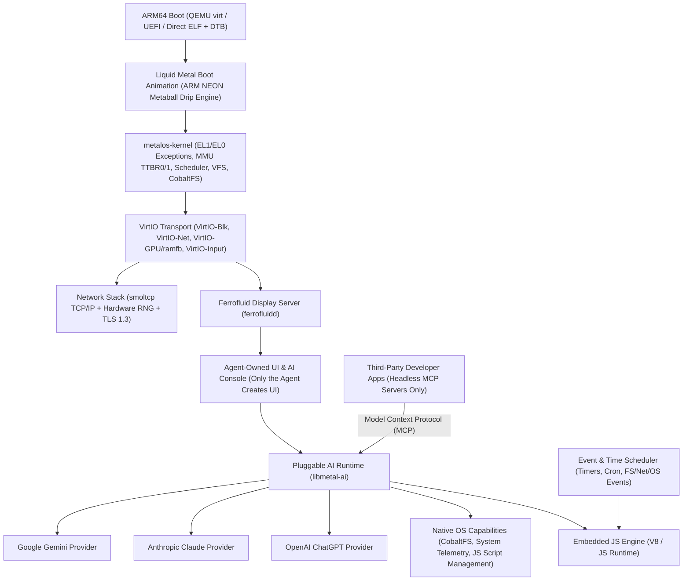

# metalOS Roadmap

**metalOS** is an AI-first, single-user, bare-metal `aarch64` (ARM64) operating system written in `#![no_std]` Rust, optimized for native Apple Silicon (**M4** via `Hypervisor.framework` / `-accel hvf`) and QEMU `virt`. Rather than bolting AI onto a legacy multi-user desktop metaphor, metalOS boots through a liquid-metal splash animation directly into **Ferrofluid (`ferrofluidd`)**—a lightweight display server initialized with a single terminal-style AI chat window backed by pluggable frontier models (**Gemini**, **Claude**, **ChatGPT**).

### Core Architectural Invariants
- **Single-User by Design**: Personal devices are single-owner devices. metalOS intentionally omits multi-user support (no UIDs/GIDs, user session switching, `/home/<user>` hierarchies, or cross-user permission matrices). Security and isolation boundaries exist strictly between **the AI Agent** and **capability-scoped JS isolates / headless MCP apps**, eliminating an entire class of state-synchronization and permission bugs.
- **No Shell for the AI**: The AI agent cannot see or execute shell commands (`sh`, `exec`, `spawn`). It interacts with the OS exclusively through typed native tools, local JavaScript (`metalos-js`), and MCP servers.
- **Agent-Exclusive UI**: Third-party developer apps are strictly headless MCP servers (`metalos-mcp`). Only the AI agent is permitted to create and update UI surfaces in **Ferrofluid (`ferrofluidd`)**.

---

## Architecture Overview



---

## Phase 1: Initial Foundation & `aarch64` Pivot (Apple M4 Native)

We started with a working kernel, VFS, **CobaltFS**, and minimal debug CLI (`sh`) on `x86_64`, and are pivoting the hardware layer to **`aarch64-unknown-none`** so metalOS executes natively on Apple M4 silicon via `qemu-system-aarch64 -M virt -cpu host -accel hvf`.

- [x] **Portable Kernel Subsystems (`crates/metalos-kernel`)**
  - VFS switch (`crates/metalos-kernel/src/fs/vfs.rs`) with mount table
  - **CobaltFS** (`crates/metalos-kernel/src/fs/cobaltfs`): persistent ext2-inspired disk filesystem
  - **RamFS** and **DevFS** (`/dev/null`, `/dev/zero`, `/dev/serial`)
  - Kernel heap allocator, frame allocator, round-robin task scheduler, and syscall dispatcher
- [x] **Userland Standard Library & Minimal Debug CLI (`crates/metalos-user`)**
  - `libmetal` syscall wrappers, file I/O, and process management
  - Minimal bring-up/debug shell (`sh`) with basic utilities—kept intentionally small since metalOS is an AI-first OS rather than a traditional POSIX shell environment
- [x] **ARM64 (`aarch64`) Architecture Port (`crates/metalos-kernel/src/arch`)**
  - **Boot & Linker**: Boot on QEMU `-M virt` (`-cpu host -accel hvf` on Apple Silicon) via `linker-aarch64.ld` (`0x4008_0000`)
  - **Exception Levels & Syscalls**: ARMv8 Exception Vector Table (`VBAR_EL1`), `EL2` $\rightarrow$ `EL1h` drop, and `svc #0` syscall trap
  - **MMU & Paging**: ARMv8 Stage-1 `TTBR0_EL1` translation tables (`0x0000_0000..0x4000_0000` Device-nGnRnE MMIO, `0x4000_0000..0x8000_0000` Normal Write-Back Inner-Shareable RAM)
  - **Serial & Block I/O**: **PL011 UART** MMIO driver (`0x0900_0000`) and **VirtIO-Blk** MMIO block driver (`0x0a00_0000`) backing **CobaltFS**
  - **Power Management**: ARM **PSCI** (`SYSTEM_OFF` via `hvc #0`) for clean QEMU shutdown
  - **Native Host Tests (`xtask`)**: Run `cargo test --workspace` natively on `aarch64-apple-darwin` without Rosetta

---

## Phase 2: Networking Stack & HTTPS Client

To communicate directly with cloud LLM APIs (Gemini, Claude, ChatGPT) from bare metal, metalOS uses VirtIO networking and a `#![no_std]` cryptographic stack accelerated by ARMv8 Crypto/NEON instructions.

- [x] **VirtIO-Net Driver**
  - Memory-mapped VirtIO-Net driver in `crates/metalos-kernel/src/drivers/virtio_net.rs` sharing the common VirtIO queue transport with VirtIO-Blk
- [x] **TCP/IP Stack Integration**
  - `#![no_std]` TCP/IP stack in `crates/metalos-kernel/src/net/mod.rs` (`ARP`, `IPv4`, `ICMP`, `UDP`, `DHCP`, `TCP`, `DNS`)
  - Expose socket syscalls (`SYS_SOCKET`, `SYS_CONNECT`, `SYS_SEND`, `SYS_RECV`, `SYS_CLOSE`) in `crates/metalos-proto`
- [x] **Hardware RNG & TLS 1.3**
  - ARMv8.5-RNG (`RNDR` / `RNDRRS`) + ChaCha20 CSPRNG entropy source (`crates/metalos-kernel/src/drivers/rng.rs`) exposed via `/dev/urandom` and `SYS_GETRANDOM`
  - `#![no_std]` TLS 1.3 client (`crates/metalos-user/src/net/mod.rs`) with root CA store verifier (`/etc/ssl/certs.pem`)
- [x] **HTTP/1.1 & Server-Sent Events (SSE) Client**
  - Streaming HTTPS client in `crates/metalos-user/src/net/mod.rs` supporting chunked transfer encoding and SSE token streaming for real-time LLM responses

---

## Phase 3: Boot Splash & Liquid Metal Drip Animation

During boot, before transitioning into the interactive workspace, metalOS renders a signature **Liquid Metal Drip** animation based on `assets/logo.svg`, accelerated by **ARM NEON SIMD** on M4.

- [x] **VirtIO-GPU / `ramfb` Framebuffer Driver**
  - High-resolution 32-bpp linear framebuffer (`crates/metalos-kernel/src/drivers/virtio_gpu.rs`) via QEMU `virtio-gpu-device`
  - Double-buffered framebuffer driver with fast NEON 128-bit scanline blitting and dirty-rect updates
- [x] **2D Metaball & Surface-Tension Scalar Field Engine**
  - Recreate the `crystal-weld` and `mercury-type` SVG filter physics (`feGaussianBlur` + high-contrast alpha thresholding `28*a - 11`) in a real-time `#![no_std]` ARM NEON shader (`crates/metalos-boot/src/splash.rs`)
  - Render the **metalOS** viscous meniscus wordmark and **Ferrofluid Crystal Emblem** on a pure `#000000` canvas
- [x] **Viscous Drip Physics During Kernel Init**
  - Animate molten mercury droplets detaching from the bottom meniscus bridges of the `metalOS` typography and ferrofluid spikes, stretching under simulated gravity and surface tension before coalescing into the initial **Ferrofluid** terminal window border

---

## Phase 4: Ferrofluid (`ferrofluidd`) — GUI Display Server & Compositor

**Ferrofluid (`ferrofluidd`)** is the display server and window compositor for metalOS. It initializes directly into a single, distraction-free, terminal-like window that serves as the AI chat interface, and **only the AI agent is permitted to create and render UI surfaces**.

- [x] **Ferrofluid Display Server Core (`crates/metalos-ferrofluid` / `ferrofluidd`)**
  - Manages the VirtIO-GPU framebuffer, dirty-rectangle damage tracking, and vsync pacing
  - Input event multiplexing from **VirtIO-Input** (`crates/metalos-kernel/src/drivers/virtio_input.rs`)
  - Lightweight IPC protocol over shared memory rings (`SYS_SHM` / IPC channels) restricted exclusively to the AI agent runtime (`AgentUiToken`) for surface creation and input events
- [x] **Ferrofluid Aesthetic & Rendering Primitives**
  - Crisp monochrome & liquid-mercury visual language (deep obsidian `#000000`/`#0A0A0C` background, specular silver/chrome borders, anti-aliased bitmap monospace typography)
  - Smooth cursor rendering, scrollback viewport, markdown/code-block formatting, and agent-synthesized interactive widgets/views (`AiConsoleView`, `MetricCard`, `DataTable`, `Sparkline`, `StatusBanner`)
- [x] **Single-Window AI Boot Mode**
  - On startup, `ferrofluidd` transitions seamlessly from the boot drip animation into a single centered (or fullscreen) terminal-like window—the **Ferrofluid AI Console**

---

## Phase 5: AI-First Console & Pluggable Model Runtime

Because metalOS is an **AI-first operating system**, there are very few traditional shell commands, and **the AI agent cannot see or execute shell commands**. Instead of wrapping a legacy POSIX shell, the Ferrofluid console is a pure conversational AI interface backed by structured OS capabilities and an embedded scripting engine.

- [x] **Pluggable Provider Trait (`crates/metalos-ai`)**
  - Unified `AiModelProvider` interface supporting streaming token generation, conversation history, system prompts, and tool/function calling:
    ```rust
    pub trait AiModelProvider {
        fn name(&self) -> &'static str;
        fn stream_chat(
            &mut self,
            messages: &[Message],
            tools: &[ToolSpec],
            on_token: &mut dyn FnMut(&str),
        ) -> Result<Response, AiError>;
    }
    ```
- [x] **First-Class Model Adapters**
  - **Gemini Provider**: Google Gemini API (`generateContent` / `streamGenerateContent` over SSE)
  - **Claude Provider**: Anthropic Messages API (`/v1/messages` with streaming SSE)
  - **ChatGPT Provider**: OpenAI Chat Completions / Responses API (`/v1/chat/completions` with streaming SSE)
  - Runtime hot-swapping via slash commands (`/model gemini`, `/model claude`, `/model chatgpt`) and persistent config in CobaltFS (`/etc/ai.conf`)
- [x] **Shell-Free Native OS Tool-Use**
  - The AI agent has **no access to `sh` or raw shell execution**. Instead, it interacts with metalOS exclusively through strongly-typed native OS tools, MCP servers, and JavaScript automation:
    - `fs_read` / `fs_write` / `fs_list` (direct CobaltFS & VFS operations)
    - `sys_status` (inspect memory allocation, active tasks, network interfaces, and uptime)
    - `script_create` / `script_run` / `script_schedule` (author, execute, and schedule local JavaScript programs)
    - `mcp_list_tools` / `mcp_call_tool` / `mcp_read_resource` / `ui_render_view`

---

## Phase 6: Embedded JavaScript Engine (V8 / JS Runtime) & Event/Time Scheduler

Rather than relying on shell scripts or CLI binaries, the AI model extends and automates metalOS by writing **local JavaScript scripts** executed inside an embedded JS engine (V8 or a lightweight embeddable JS engine) with first-class scheduling based on **system events** or **time**.

- [x] **Embedded JavaScript Engine (`crates/metalos-js`)**
  - `#![no_std]` JavaScript engine (`V8Isolate` / `JsRuntime`) executing model-authored scripts in isolated contexts with deterministic instruction fuel limits
  - Safe, capability-scoped host bindings (`MetalOS.*` global API) for filesystem access (CobaltFS), HTTP/network requests, system metrics, and Ferrofluid UI notifications—with zero shell access (`JsError::ForbiddenCapability`)
- [x] **Model-Authored Local Scripts**
  - Allow the AI agent to write, update, inspect, and persist local `.js` scripts on CobaltFS (e.g., `/scripts/*.js`) to fulfill user workflows, background tasks, and custom OS behaviors
- [x] **Time-Based & Event-Driven Script Scheduler (`scriptd`)**
  - **Time Triggers**: Schedule scripts via one-shot timers (`OnceAtMs`), recurring intervals (`IntervalMs`), or 5-field cron expressions (`CronExpr`) backed by the ARM Generic Timer
  - **Event Triggers**: Trigger scripts reactively on OS and userland events, including:
    - Filesystem events (file created, modified, or deleted on CobaltFS with glob matching)
    - Network events (interface up/down, incoming socket data, webhook/poll responses)
    - System lifecycle & IPC events (boot completion, low memory/resource thresholds, user idle)
  - Persistent schedule registry stored on CobaltFS (`/etc/schedules.conf`) so model-created automations survive reboots

---

## Phase 7: Developer App Platform (MCP-Only) & Agent-Exclusive UI

In metalOS, third-party developers can build and distribute applications, but **apps are strictly limited to exposing Model Context Protocol (MCP) interfaces**. Applications never render their own windows or widgets—**only the AI agent creates UI**.

- [x] **Apps as Headless MCP Servers (`crates/metalos-mcp`)**
  - Developers write metalOS apps that register strictly as **MCP servers** over JSON-RPC 2.0 / local IPC channels
  - Apps expose capabilities exclusively through standard MCP primitives: **Tools** (executable actions), **Resources** (structured data/state), and **Prompts** (context templates)
  - Built-in headless MCP apps (`NotesVaultApp`, `TaskBoardApp`, `SysPulseApp`) and `/apps/*.mcp` manifest discovery
- [x] **Zero App-Owned UI Enforcement**
  - `validate_app_manifest` and `RuntimeCapabilityGuard` reject any app requesting `CreateWindow`, `DirectFramebuffer`, `RawInputCapture`, or `ShellExecution`
  - Developer apps have no access to `ferrofluidd` window surfaces, framebuffers, or direct user input streams
- [x] **Agent-Synthesized Generative UI**
  - **Only the AI agent can create, compose, and update UI** inside **Ferrofluid (`ferrofluidd`)**
  - When a user interacts with one or more apps, the agent invokes their MCP tools/resources and dynamically synthesizes the appropriate visual presentation, interactive controls, or data views tailored to the user's immediate intent

---

## Milestone Summary

| Milestone | Deliverable | Target Crate(s) | Status |
|---|---|---|---|
| **M1: ARM64 Core & VFS** | `aarch64` kernel (HVF), PL011, VirtIO-Blk, CobaltFS | `metalos-kernel`, `metalos-user` | Complete (Native M4 HVF) |
| **M2: Connected Metal** | VirtIO-Net, TCP/IP, DNS, TLS 1.3, HTTPS SSE client | `metalos-kernel`, `metalos-user` | Complete |
| **M3: Liquid Boot** | VirtIO-GPU framebuffer + NEON dripping liquid-metal animation | `metalos-boot`, `metalos-kernel` | Complete |
| **M4: Ferrofluid GUI (`ferrofluidd`)** | Display server booting into single terminal-style window | `metalos-ferrofluid`, `metalos-kernel` | Complete |
| **M5: Pluggable AI OS** | Gemini, Claude & ChatGPT providers + shell-free native OS tools | `metalos-ai`, `metalos-user` | Complete |
| **M6: JS Engine & Scheduler** | Embedded V8/JS runtime for model-authored scripts + time/event scheduling | `metalos-js`, `metalos-user` | Complete |
| **M7: MCP Apps & Agent UI** | Headless MCP-only developer app SDK + agent-exclusive UI synthesis | `metalos-mcp`, `metalos-ferrofluid`, `metalos-ai` | Complete |
